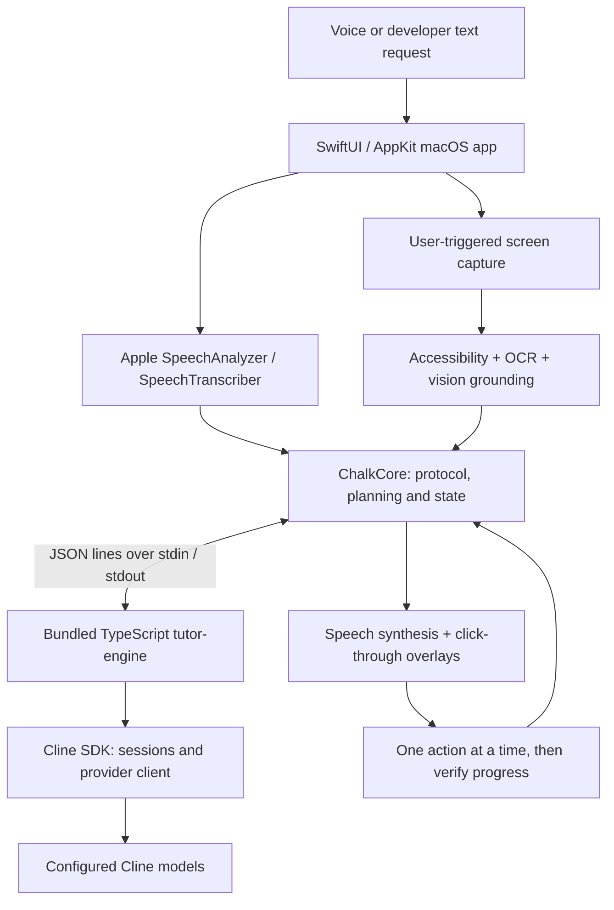

# Chalk — your screen-side guide

## The problem: connected isn't the same as empowered

India is getting online, but access to digital tools does not automatically translate into confidence using them. People may have devices and internet access yet still struggle with unfamiliar interfaces, online forms, email, or simply knowing what to do next. **The gap isn't just access to technology; it's the ability to use it confidently.**

The problem research presented in our project slides highlights two distinct measures:

| Measure | Finding | Population and scope |
| --- | --- | --- |
| Practical capability | **26.8%** | Indian youth aged 15–24 who reported all three abilities: searching for information online, sending or receiving emails, and conducting online banking transactions. |
| Household connectivity | **86.3%** | Indian households with internet access within their household premises in 2025. |

Sources cited in the project slides: **MoSPI** (`mospi-gov-in-678000a5`) for practical capability and **PIB** (`pib-gov-in-ede1d033`) for household connectivity. These figures describe different populations and measures; they are not a direct like-for-like comparison.

## Who we're building for

**Digital confidence should have no age or barrier.** From everyday tasks to new skills, everyone deserves a guide.

- **Senior citizens:** build independence when sending an email, attaching a document, or joining an online meeting, without always waiting for someone else's help.
- **Children and students:** understand unfamiliar material, learn software, and practise digital skills beyond the classroom at a self-directed pace.
- **Women:** navigate online applications, documents, and unfamiliar services with greater confidence, agency, and independence.
- **Anyone learning something new:** explore unfamiliar tools through on-demand guidance and self-paced practice, with less dependence on constant one-to-one help.

## Our approach

Chalk brings guidance to the screen where the task is happening. Instead of leaving users to translate generic instructions into unfamiliar interfaces, it explains, points, and walks through the next step while the user performs the action. The goal is to build practical confidence—not take control away from the person learning. The current implementation is a native macOS app; broader digital inclusion is the motivation, not a claim of support for every device or platform.

Chalk is a native macOS assistant that explains what is on your screen, speaks its answer, points to controls, draws annotations, and guides you through tasks one step at a time. Hold **Control + Option** to ask a question. You stay in control of every click and keystroke.

## Architecture



- **Native app (`Chalk/`)** owns permissions, microphone input, screen capture, accessibility reads, OCR, menu-bar controls, captions and overlays. Speech recognition and synthesis use Apple frameworks, not cloud speech services.
- **Domain layer (`Packages/ChalkCore/`)** contains first-party Swift source for protocol validation, coordinates, annotations, model routing, process supervision and walkthrough state. It is a local source package, **not downloaded dependencies**.
- **Reasoning sidecar (`Sidecar/`)** uses the exact-pinned `@cline/sdk` version `0.0.90`. Bun compiles it into `tutor-engine`, which Xcode embeds in the app. Swift communicates with it through JSON-lines stdin/stdout. Model slots and profiles are configured in `Sidecar/model-routing.json`.
- **Guidance** uses a persistent rolling Guide with bounded helper roles. Swift validates proposed actions, checks current app/control preconditions and owns progress; saved how-tos retain a local executor.
- **Output** combines `AVSpeechSynthesizer` with timed, click-through drawings and a ghost cursor. Chalk does not move your real cursor or inject keyboard/mouse events.

Screenshots are triggered by user interaction, not background monitoring. Accessibility reads are bounded to the foreground app during an active request. OAuth credentials stay outside the repository. Live diagnostics are in-memory and omit credential, image and accounting events.

## Requirements

- **macOS 26 or newer** (required for the speech APIs).
- **Xcode with the macOS 26 SDK or newer** and Swift 6.2+. The development environment uses Xcode 27.
- **Bun**; development uses Bun 1.4.2. Install from [bun.sh](https://bun.sh/).
- **Node.js** on your PATH for SDK tooling; development uses Node 22.23.3.
- A **Cline account with model access/credits** for the default `demo` profile. Model availability depends on your account; review `Sidecar/model-routing.json` if a configured model is unavailable.

No installed packages, compiled sidecar, app bundle or build cache is committed. Dependency manifests and `Sidecar/bun.lock` are included so you can install dependencies locally.

## Run locally

### 1. Clone and install dependencies

```sh
git clone https://github.com/CIPHERclux/cline-hackathon.git
cd cline-hackathon
cd Sidecar
bun install --frozen-lockfile
bun run build:bin
cd ..
```

**Build the sidecar first.** The Xcode project expects `Sidecar/dist/tutor-engine` and embeds it into `Chalk.app/Contents/Helpers/`. Rebuild it after changing sidecar code. Build on the Mac/architecture where you intend to run the app.

### 2. Sign in to Cline

Run this in your own terminal and follow the browser sign-in flow:

```sh
bun Sidecar/scripts/cline-login.ts
```

The SDK stores OAuth credentials under `~/Library/Application Support/Chalk/cline`, not in the repository. The default `demo` profile uses this account; live requests can consume credits.

### 3. Open and run the native app

```sh
open Chalk.xcodeproj
```

Select the **Chalk** scheme and **My Mac**, then press **⌘R**. If signing needs configuration, use the gitignored `Config/Signing.local.xcconfig`, which is optionally included by `Config/Signing.xcconfig`. Do not commit developer identities or team credentials.

Complete the setup panel and grant the requested **Microphone, Speech Recognition, Accessibility and Screen Recording/Screen Content** permissions. If macOS requests a restart after granting screen access, quit and run again from Xcode.

### 4. Ask about your screen

Hold **Control + Option** and ask about an error, setting, chart or task. Chalk responds aloud and highlights the relevant screen area. For guided tasks, perform the suggested action yourself and let Chalk verify progress.

For microphone-free testing, open the menu-bar panel → **Developer options** → **Text input · spoken responses**, enable it, type a request and send. The same response pipeline and screen permissions apply. **Live Logs** offers temporary operational diagnostics.

## Build and test

From the repository root, after building the sidecar:

```sh
# Compile only; this does not launch the app or produce a signed distribution.
xcodebuild -project Chalk.xcodeproj -scheme Chalk -configuration Debug \
  -derivedDataPath build/DerivedData build CODE_SIGNING_ALLOWED=NO

# Headless Swift domain tests.
swift test --package-path Packages/ChalkCore

# TypeScript checks and local stub-provider tests (no Cline credits).
cd Sidecar
bun run typecheck
bun test

# Optional: run the same contract tests against the compiled engine.
CHALK_ENGINE_BINARY="$PWD/dist/tutor-engine" bun test
```

App-hosted tests in `ChalkTests/` and `ChalkUITests/` launch the app and may require macOS permissions; they are separate from the headless checks above. Real-model evaluation scripts may consume credits and are not required to run the unit tests.

## Repository layout

| Path | Purpose |
| --- | --- |
| `Chalk/` | Native app source and required bundled assets |
| `Chalk.xcodeproj/` | Xcode project and shared scheme |
| `Packages/ChalkCore/` | First-party Swift domain source and tests |
| `Sidecar/src/` | Cline engine, routing and IPC protocol |
| `Sidecar/resources/` | Engine prompts and schemas |
| `Sidecar/test/`, `Sidecar/scripts/` | Stub tests, authentication and build tooling |
| `ChalkTests/`, `ChalkUITests/` | App and UI tests |
| `Config/` | Shared signing configuration; local overrides are ignored |
| `Eval/` | Evaluation source, scenarios and fixtures |
| `scripts/` | Identity generation, verification and release tooling |
| `docs/` | Product specification, demo plan and architecture decisions |

See `docs/PRODUCT_SPEC.md` for the full design and `docs/ADAPTIVE_GUIDANCE_TESTING.md` for guidance verification. Older experimental-mode notes are superseded by the rolling Guide architecture.

## Troubleshooting

- **Missing `tutor-engine`:** run `cd Sidecar && bun run build:bin`, then rebuild in Xcode.
- **Authentication/model errors:** rerun the Cline login script, check account access/credits and review the configured model IDs. No provider credentials should be committed.
- **Capture or microphone unavailable:** verify permissions in System Settings → Privacy & Security, then restart the app if required.
- **Package paths refer to an old checkout:** use fresh DerivedData or reset Xcode package caches after moving/renaming the repository.

## License

MIT. Preserve the original copyright and permission notice in `LICENSE` with copies or substantial portions of the software.