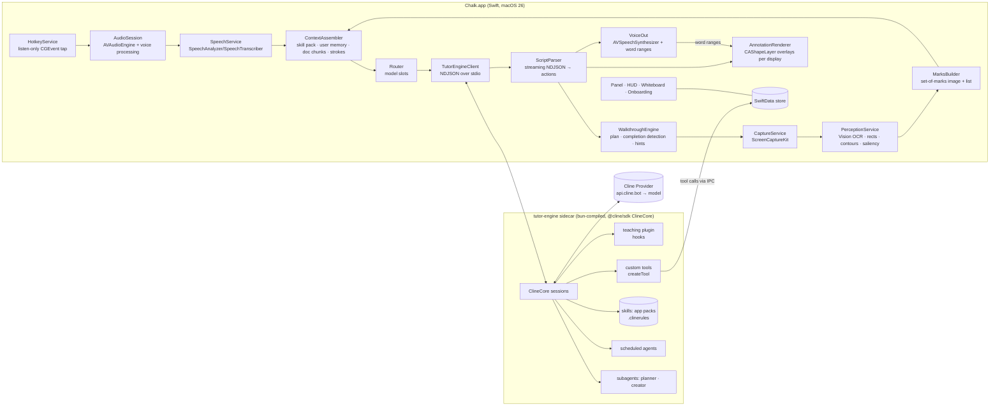
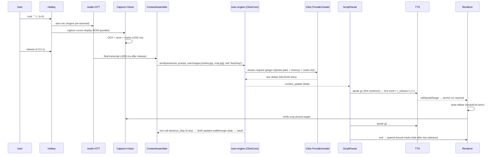

# Chalk: Product & Technical Specification
### A native macOS screen guide that talks, points, draws and walks you through anything on your real screen

| | |
|---|---|
| Status | Draft v0.2, 2026‑10‑10. v0.1 (2026‑10‑02) was teaching-first; v0.2 refocuses on general daily use (D67) |
| Base | `farzaa/clicky` open-source v1 snapshot (MIT), this repository |
| AI engine | **Cline only**, via the `@cline/sdk` (pinned), any Cline‑offered model chosen per purpose |
| Speech | Apple-native only: SpeechAnalyzer/SpeechTranscriber (STT), AVSpeechSynthesizer (TTS) |
| Minimum OS | **macOS 26** |
| First milestone | Hackathon demo (see §4.7 and §13) |
| Working name | **Chalk** (alternatives in §1.2) |

**Conventions.**
- **[ASSUMPTION]** marks something we decided without proof.
- **[OPEN QUESTION]** marks something the owner must answer; all are collected in §16.3.
- **(secondhand)** marks a claim we read in a third-party summary and did not verify at the primary source.
- File references are relative to the repo root.
- **Section numbers are stable.** Code comments and the demo docs cite them, so v0.2 rewrote content in place instead of renumbering. Protocol and config names from v0.1 keep their names: the Teaching Script (§6.4), the `teaching` model slot (§7.4) and the `tutor-engine` sidecar (§7.3).

**The one sentence that governs this document:** *Chalk answers you out loud while it points, draws and walks you through the thing on your screen, like a friend who knows every app sitting beside you.* Every feature below is justified by how much it strengthens that loop (**listen → see → speak + point + draw → guide → confirm**). Anything that does not strengthen it is cut or deferred.

---

## Table of contents
0. [As-Is Architecture Audit](#0-as-is-architecture-audit)
1. [Vision & positioning](#1-vision--positioning)
2. [Personas & core scenarios](#2-personas--core-scenarios)
3. [Product principles](#3-product-principles)
4. [Feature set](#4-feature-set)
5. [UX & interaction design](#5-ux--interaction-design)
6. [Grounding & annotation engine](#6-grounding--annotation-engine)
7. [Target architecture](#7-target-architecture-rewired)
8. [Rewiring map](#8-rewiring-map)
9. [Apple frameworks plan](#9-apple-frameworks-plan)
10. [Privacy, security & permissions](#10-privacy-security--permissions)
11. [Quality, reliability & evaluation](#11-quality-reliability--evaluation)
12. [Distribution & business](#12-distribution--business)
13. [Roadmap](#13-roadmap)
14. [Risks & mitigations](#14-risks--mitigations)
15. [Phase-0 technical spikes](#15-phase-0-technical-spikes)
16. [Appendix](#16-appendix)

---

## 0. As-Is Architecture Audit

Every statement below comes from reading the file cited. The repo is about 8.5k lines: 24 Swift files, 1 TypeScript worker, 3 unit tests and 2 template UI tests.

### 0.1 Shape of the app

```
ChalkApp (SwiftUI @main, empty Settings scene)
 └─ CompanionAppDelegate (@NSApplicationDelegateAdaptor)
     ├─ MenuBarPanelManager ── NSStatusItem + KeyablePanel(NSPanel) ── ChalkControlPanel (SwiftUI)
     └─ CompanionManager (@MainActor ObservableObject, "god object", 1,026 lines)
          ├─ GlobalPushToTalkShortcutMonitor (listen-only CGEvent tap)
          ├─ BuddyDictationManager (AVAudioEngine → BuddyTranscriptionProvider)
          │     ├─ AssemblyAIStreamingTranscriptionProvider (websocket, default via Info.plist)
          │     ├─ OpenAIAudioTranscriptionProvider (upload WAV)
          │     └─ AppleSpeechTranscriptionProvider (SFSpeechRecognizer)
          ├─ CompanionScreenCaptureUtility (ScreenCaptureKit, all displays, JPEG)
          ├─ ClaudeAPI (SSE via Cloudflare Worker /chat)
          ├─ ElevenLabsTTSClient (whole-file MP3 via Worker /tts, AVAudioPlayer)
          └─ ScreenBeaconOverlayManager ── ScreenBeaconOverlay (1 per NSScreen) ── ChalkCursorView (SwiftUI)
worker/src/index.ts (Cloudflare Worker: /chat → Anthropic, /tts → ElevenLabs, /transcribe-token → AssemblyAI)
```

### 0.2 Lifecycle
- **Entry.** `Chalk/ChalkApp.swift` declares `ChalkApp` with only `Settings { EmptyView() }`, and `Info.plist` sets `LSUIElement = true` (no Dock icon).
- **Launch.** `CompanionAppDelegate.applicationDidFinishLaunching`:
  - configures PostHog (`ClickyAnalytics.configure`);
  - creates `MenuBarPanelManager`;
  - calls `companionManager.start()`;
  - auto-opens the panel if onboarding or permissions are incomplete;
  - registers a login item via `SMAppService.mainApp.register()` **without asking the user**.
- **Sparkle.** `startSparkleUpdater()` exists but its call is commented out. `Info.plist` `SUFeedURL` and `appcast.xml` still point at a different product ("makesomething", `julianjear/makesomething-mac-app`).
- **Automatic Termination exposure.** The app has no regular windows and never calls `ProcessInfo.processInfo.disableAutomaticTermination(_:)`. This is exactly the condition under which HeyClicky's app was quit mid-setup (HeyClicky changelog v1.0.51, "automatic termination during setup").

### 0.3 Windows: panel and overlays
- **Menu-bar panel.** `MenuBarPanelManager` creates an `NSStatusItem` with a hand-drawn triangle icon (`makeClickyMenuBarIcon`). Clicking it toggles a borderless `KeyablePanel` (`.nonactivatingPanel`, `.floating` level, `[.canJoinAllSpaces, .fullScreenAuxiliary]`), positioned under the status item from `statusItem.button.window.frame`. Dismissal:
  - a global `leftMouseDown`/`rightMouseDown` monitor with a 0.3 s delay, suppressed while permissions are missing;
  - a `.clickyDismissPanel` notification.
- **Overlay windows.** `ScreenBeaconOverlay` (`Chalk/ScreenBeaconOverlay.swift`) is one borderless `NSWindow` per `NSScreen`:
  - `level = .screenSaver`, `ignoresMouseEvents = true` (click-through);
  - `collectionBehavior = [.canJoinAllSpaces, .stationary, .fullScreenAuxiliary]`;
  - `canBecomeKey`/`canBecomeMain` return false;
  - frame = `screen.frame`.
- **Overlay content.** `ScreenBeaconOverlayManager.showOverlay` tears down and recreates all overlays each time, hosting `ChalkCursorView` in an `NSHostingView`.
  - The root `ZStack` starts with **`Color.black.opacity(0.001)` filling the entire screen** (`ScreenBeaconOverlay.swift:187`). The result is a full-screen, nearly-but-not-fully transparent window above everything at screen-saver level.
  - **This is the prime suspect for the "window screenshots / Loom share-window come out black or covered" class of bugs** HeyClicky reported. A capture tool sees a top-level window covering the display and composites its non-zero-alpha pixels. It must be fixed (§6.6).
- **Screen hot-plug.** No `NSApplication.didChangeScreenParametersNotification` handling exists. Overlays are rebuilt only when `showOverlay` is called again, so hot-plugged or rearranged displays leave stale overlays. This relates to HeyClicky's "cursor landing on wrong monitor after display rearrange" (v1.0.29).

### 0.4 Permissions
- **Polling.** `CompanionManager.startPermissionPolling` re-checks every **1.5 s forever**, even after everything is granted.
- **Sources:**
  - Accessibility: `WindowPositionManager.hasAccessibilityPermission()`, i.e. `AXIsProcessTrusted`.
  - Screen Recording: `CGPreflightScreenCaptureAccess`, with a UserDefaults "previously confirmed" fallback.
  - Microphone: `AVCaptureDevice.authorizationStatus`.
  - "Screen Content": a dummy 320×240 `SCScreenshotManager.captureImage` whose success is persisted in UserDefaults and **never re-validated** (`requestScreenContentPermission`).
- **Accessibility gates push-to-talk.** `refreshAllPermissions` starts the event tap only if AX is trusted. Accessibility is therefore required for the hotkey, not for reading UI.
- **Request strategy.** `WindowPositionManager.permissionRequestPresentationDestination` shows the system prompt once, then opens System Settings. This is the only logic covered by unit tests (`leanring-buddyTests/ChalkTests.swift`).
- **Onboarding copy.** `ChalkControlPanel.permissionsCopySection` promises "Nothing runs in the background. Clicky will only take a screenshot when you press the hot key". The code honours this: captures happen only in `sendTranscriptToClaudeWithScreenshot` and the onboarding demo.

### 0.5 Push-to-talk pipeline
1. **Hotkey.** `GlobalPushToTalkShortcutMonitor` installs a `.cgSessionEventTap`, `.listenOnly`, for `flagsChanged/keyDown/keyUp` on the main run loop, and re-enables itself on `tapDisabledByTimeout`. The shortcut is hard-coded: `BuddyPushToTalkShortcut.currentShortcutOption = .controlOption` (`BuddyDictationManager.swift`). Nothing is user-configurable, and double-tap is not supported.
2. **Press.** `CompanionManager.handleShortcutTransition(.pressed)`:
   - cancels the in-flight response and TTS;
   - clears the pointing target;
   - dismisses the panel;
   - calls `BuddyDictationManager.startPushToTalkFromKeyboardShortcut`.
3. **Recording.** `BuddyDictationManager`:
   - requests mic and speech permission with de-duplication (`requestMicrophoneAndSpeechPermissionsWithoutDuplicatePrompts`);
   - installs an `AVAudioEngine.inputNode` tap (1024 frames, hardware format);
   - streams buffers to the provider session;
   - computes an RMS power level for the waveform.
   - There is **no voice processing (echo cancellation)**, **no route-change / device-loss handling**, and no input device selection.
4. **Release.** The engine stops, `requestFinalTranscript()` is called, and a fallback timer (provider-specific, 1.8–2.4 s) force-finishes.
5. **Provider choice.** `BuddyTranscriptionProviderFactory` reads `VoiceTranscriptionProvider` from `Info.plist` (= `assemblyai`), then falls back to OpenAI, then Apple.
   - `AppleSpeechTranscriptionProvider` already uses `SFSpeechRecognizer` with `requiresOnDeviceRecognition` when supported, partial results and `addsPunctuation`.
   - Keyterm biasing is hard-coded and stale (`buildTranscriptionKeyterms`: "makesomething", "Codex"…), and Apple ignores keyterms entirely.

### 0.6 Screenshot pipeline & coordinate systems
- **Capture.** `CompanionScreenCaptureUtility.captureAllScreensAsJPEG()`:
  - calls `SCShareableContent.excludingDesktopWindows(false, onScreenWindowsOnly: true)`;
  - **excludes all windows owned by our bundle ID** via `SCContentFilter(display:excludingWindows:)`. This is correct: our own captures never contain the overlay.
  - Maps `SCDisplay.displayID` → `NSScreen` (`NSScreenNumber`) to get AppKit (bottom-left) frames.
  - Sorts the cursor's screen first, captures each display at **max 1280 px** on the long edge, encodes JPEG q=0.8, and labels each image "screen N of M — cursor is on this screen (primary focus)".
- **Coordinate chain** (`CompanionManager.swift`, ~lines 640–677): model pixel (top-left, screenshot space) → clamp → scale to display points (`displayWidthInPoints / screenshotWidthInPixels`) → flip Y to AppKit bottom-left → add `displayFrame.origin` → global AppKit point. `ChalkCursorView.convertScreenPointToSwiftUICoordinates` flips back into per-overlay SwiftUI space.
- **Duplication.** The identical math is duplicated in `performOnboardingDemoInteraction`.
- **Retina.** Handled implicitly, because the image is downscaled to 1280 px and only point-space is used. Sub-pixel accuracy is poor: one model pixel ≈ 1.2–2.3 pt on common displays.
- **No OCR, no candidate detection, no verification.** The model guesses raw pixels from a 1280 px JPEG.
- **Dead variant.** `ElementLocationDetector.swift` contains a more careful approach: aspect-matched Computer-Use resolutions and a Retina-safe `NSBitmapImageRep` resize. It is **dead code**: never instantiated, and it calls `https://api.anthropic.com/v1/messages` directly with an API key.

### 0.7 Conversation, prompting and the POINT protocol
- **History.** `CompanionManager.conversationHistory` is an in-memory array of `(userTranscript, assistantResponse)` strings, capped at 10 and lost on quit. Screenshots are not retained in history.
- **System prompt.** `companionVoiceResponseSystemPrompt` is a lowercase, conversational persona that "can help with anything". It instructs the model to append **one** `[POINT:x,y:label(:screenN)]` or `[POINT:none]` at the end.
- **Parser.** `CompanionManager.parsePointingCoordinates` uses a regex **anchored to the end of the response** (`\]\s*$`). Consequences:
  - at most one target per answer;
  - any trailing text after the tag silently disables pointing;
  - no streaming parse;
  - no shapes;
  - the label is used only for analytics.
- **Pointing animation.** `ChalkCursorView.startNavigatingToElement` → `animateBezierFlightArc`: a `Timer` at 60 Hz driving a quadratic bezier with smoothstep easing, tangent rotation and a 1.0→1.3→1.0 scale pulse, lasting 0.6–1.4 s depending on distance. After landing, `startPointingAtElement` streams a bubble phrase character by character, holds 3 s, and flies back (`startFlyingBackToCursor`).
- **Cursor following.** `startTrackingCursor` runs a **60 Hz `Timer` on every screen's overlay, permanently**, reading `NSEvent.mouseLocation`. This is the main idle-CPU cost; HeyClicky reports going from 36–43% to 3–5% idle CPU (v1.0.49).

### 0.8 Response → speech
- `sendTranscriptToClaudeWithScreenshot`:
  1. captures all screens;
  2. awaits **the complete** Claude SSE stream (`ClaudeAPI.analyzeImageStreaming`; `onTextChunk` ignored);
  3. parses POINT;
  4. sends the **whole** text to ElevenLabs;
  5. waits for the **whole** MP3;
  6. plays it via `AVAudioPlayer`.
- **Time to first word** is therefore model total time + TTS total time. There is no sentence pipelining and no sync between words and pointing: the cursor flies when the text arrives, not when the word is spoken.
- **Barge-in.** Pressing the hotkey cancels the task and calls `stopPlayback()`. No echo cancellation is needed, because the mic is only open while the key is held.
- **Errors.** Any failure speaks a hard-coded line via `NSSpeechSynthesizer`: "I'm all out of credits. Please DM Farza…" (`speakCreditsErrorFallback`). There are no offline, timeout or muted-output states.

### 0.9 Settings, analytics, onboarding
- **Settings.** Model picker (Sonnet/Opus) persisted in UserDefaults (`ChalkControlPanel.modelPickerRow`). The "Show Clicky" toggle exists but is hidden (`showClickyCursorToggleRow` commented out).
- **Analytics.** `ClickyAnalytics` sends PostHog events with a hard-coded project key and **the full transcript (`trackUserMessageSent`) and full AI response (`trackAIResponseReceived`)**. That is incompatible with our privacy principle (§10).
- **Email capture.** `CompanionManager.submitEmail` posts the email to FormSpark and identifies the user in PostHog.
- **Onboarding.** Streams an HLS video from Mux (`setupOnboardingVideo`) and plays `ff.mp3` music. At 40 s it fires `performOnboardingDemoInteraction`, which captures the screen and asks the model to point at something "interesting" in the central 60% of the screen.

### 0.10 Build, packaging, tests
- **Build settings** (`Chalk.xcodeproj/project.pbxproj`):
  - `MACOSX_DEPLOYMENT_TARGET = 14.2`;
  - `ENABLE_APP_SANDBOX = NO`; `ENABLE_HARDENED_RUNTIME = YES` on the app target (an earlier draft said NO; that came from an uncommitted local change);
  - bundle ID `com.yourcompany.leanring-buddy`;
  - Swift 5.
- **Entitlements** (`Chalk/leanring-buddy.entitlements`): sandbox false, network client, **camera** (unused), audio input, and an SCK picker mach-lookup exception.
- **SPM pins** (`Package.resolved`): PostHog 3.47.0, Sparkle 2.9.0, PLCrashReporter 1.12.2.
- **Release.** `scripts/release.sh` (276 lines) archives, signs with Developer ID, builds a DMG, notarizes, signs for Sparkle, and publishes to GitHub. It is documented in `scripts/README.md`, still for "makesomething".
- **Tests.** 3 unit tests on permission helpers; `leanring-buddyUITests/*` are Xcode templates.
- **Stale docs.** `Chalk/AGENTS.md` describes files that do not exist (`FloatingSessionButton.swift`, `ContentView.swift`, `ScreenshotManager.swift`). `AGENTS.md` and `CLAUDE.md` are identical.

### 0.11 Dead code, hacks and leftovers

| Item | Evidence | Verdict |
|---|---|---|
| `ElementLocationDetector` | Only referenced in its own file | Delete; keep the Retina-safe resize idea |
| `ChalkResponseCardManager` (`ChalkResponseCard.swift`) | Never instantiated; comment in `CompanionManager` says it was replaced | Delete; its 60 Hz cursor-glued panel idea becomes the caption strip |
| `OpenAIAPI` | Never instantiated | Delete |
| `WindowPositionManager.pinMainWindowToRight`, `shrinkOverlappingFocusedWindow` | Unused; the latter **resizes other apps' windows via AX** | Delete (exactly the "feels watched/controlled" behaviour to avoid) |
| `BuddyDictationManager` microphone-button path, `recordedAudioPowerHistory`, `updateContextualKeyterms` | No callers outside the file | Fold into new STT service |
| `ChalkControlPanel.showClickyCursorToggleRow`, `speechToTextProviderRow`, `permissionRow` | Unreferenced or commented out | Delete |
| `enter.mp3`, `eshop.mp3`, `steve.jpg` (×2), `codex-add-project.png`, makesomething/codex imagesets in `Assets.xcassets` | No code references (only `ff.mp3` is loaded) | Delete |
| Hard-coded Worker URL placeholder | `CompanionManager.workerBaseURL`, `AssemblyAIStreamingTranscriptionProvider.tokenProxyURL` | Delete with the Worker |
| "DM Farza" credit-exhaustion speech | `speakCreditsErrorFallback` | Replace with real error states |
| Login item auto-registration without consent | `registerAsLoginItemIfNeeded` | Make opt-in |

### 0.12 Can the overlay and pointing code grow into an annotation engine?
**Yes, as a foundation, not as-is.**

| Reuse | Why it is good |
|---|---|
| One overlay window per screen, click-through, all Spaces, non-activating | The right primitive. It needs a level and `sharingType` review and a rebuild on screen change |
| Own-window exclusion in captures (`CompanionScreenCaptureUtility`) | Already correct for our own screenshots |
| Coordinate chain (pixel → point → AppKit → per-overlay) | Correct; centralize it into one `ScreenSpace` service and test it |
| Bezier flight with smoothstep, tangent rotation, scale pulse | A nice "ghost cursor"; keep as the `point` action renderer |
| `DS` tokens (`ChalkTheme.swift`) | Extend with annotation color semantics |

| Replace | Why |
|---|---|
| Single `@Published detectedElementScreenLocation` | Must become a **scene graph** of many timed shapes with lifecycles |
| `Timer`-driven 60 Hz animation and permanent cursor polling | Move to `CAShapeLayer` `strokeEnd` animations and a `CADisplayLink` that runs **only while something animates** |
| SwiftUI view per overlay re-created on every show | Persistent layer tree; SwiftUI only for captions and chrome |
| End-anchored regex protocol | Versioned, streamed Teaching Script (§6.4) |
| Raw pixel guessing | Layered grounding (§6.2) |

### 0.13 Exposure to HeyClicky's post-freeze production pitfalls

| HeyClicky pitfall (changelog) | Exposed in v1 code? | Where |
|---|---|---|
| Overlay makes window screenshots / Loom share-window black | **Yes, likely** | Full-screen `.screenSaver` window with `Color.black.opacity(0.001)` (`ScreenBeaconOverlay.swift:187`), `sharingType` default |
| Automatic Termination quits during onboarding (v1.0.51) | **Yes** | No `disableAutomaticTermination`; `LSUIElement` app with no windows |
| Bluetooth profile switch clips start of reply (v1.0.48) | **Yes** | `AVAudioPlayer` starts immediately; no pre-roll or route handling |
| Wedged mic, needs built-in failover (v1.0.48, v1.0.29) | **Yes** | `BuddyDictationManager` uses default input; no device-loss handling |
| Echo cancellation needed for barge-in (v1.0.24) | Not yet (mic only while key held), **yes once hands-free exists** | — |
| Muted Mac (v1.0.48) | **Yes**: silent failure | No output-volume check |
| Stay quiet in calls, screen sharing, Focus (v1.0.51) | **Yes** | No detection |
| Other apps' floating bars block input (v1.0.52) | Partially; the panel is `.floating` | `MenuBarPanelManager` |
| External-monitor menu-bar detection (v1.0.49 Studio Display) | **Yes** | Panel positioned from status-item window frame only |
| Hotkey or global keyboard freeze (v1.0.24, v1.0.47) | Low: tap is listen-only and re-enabled on timeout. Risk if callback work grows | `GlobalPushToTalkShortcutMonitor` |
| Idle CPU (v1.0.49) | **Yes** | Permanent 60 Hz timers per screen, 1.5 s permission poll |
| Long-conversation performance (v1.0.51) | Not yet (history capped at 10) | — |
| Region/provider blocking (v1.0.43, v1.0.47) | **Yes**, via a single Worker | Moves to Cline's provider routing (§14) |
| ⇧⌘4/⇧⌘5 needs overlay out of the way | **Yes** | No detection |
| AX queries lag heavy apps (v1.0.27, v1.0.42) | Not exposed (no AX reads); we must keep it that way | — |
| Leftover drawings / stale tour text (v1.0.47) | N/A yet, but the single-target model cannot clean multi-shape state | — |

## 1. Vision & positioning

### 1.1 Pitch
**Chalk is the friend beside your screen who knows every app.** You hold a key and ask, out loud, about whatever you are looking at: an error dialog, a DaVinci Resolve timeline, a spreadsheet, a settings pane you can't find, a chart in a report, a clause in a contract, a stack trace, a maths problem. Chalk answers in a calm voice while it **draws on your actual screen**:
- points at the control you're looking for;
- circles the number that matters;
- underlines the line that's wrong;
- arrows from cause to effect;
- sketches the diagram or writes the maths out on a whiteboard when it isn't on screen.

When you need to *do* something with several steps ("guide me how to colour grade this", "help me make a pivot table", "walk me through setting up a VPN"), Chalk walks you through it. It points at the next control, waits for you to click it, notices that you did, and moves on. If you go off script, it adapts. You stay in control: Chalk never clicks or types for you.

It is native, uses Apple speech on-device, sends a screenshot only when you ask, and reasons only through Cline.

### 1.2 Name options
| Name | Why | Risk |
|---|---|---|
| **Chalk** (recommended working name) | Draws on your screen like chalk on a board; short; verb-able ("chalk it for me") | Generic; trademark search needed [OPEN QUESTION] |
| **Margin** | Teaching happens in the margins of your real work | Less playful |
| **Tracer** | Traces and points along your screen; "trace the code flow" | Collides with dev tooling terms |

### 1.3 Target users & jobs-to-be-done
| Segment | Job-to-be-done | Today's workaround |
|---|---|---|
| People learning or returning to complex software (DaVinci Resolve, Figma, Blender, Excel, Logic, Xcode) | "Show me where, in my actual project, and walk me through it." | Pausing YouTube tutorials; forums |
| Everyday Mac users | "What is this dialog, setting or error, and what do I click?" | Searching the web; asking family; screenshots pasted into a chatbot |
| Knowledge workers | "What does this chart, clause or table say? What's the catch?" | Copy/paste into a chatbot tab |
| Developers | "Why does this fail?", answered on the actual line | Copy/paste stack traces |
| Students | "Explain this step", on the page they are reading | Chatbot tab; YouTube |
| Creators and presenters | "Annotate live while I explain, and record it." | Presentation pens; callouts added in post |

### 1.4 What we are NOT building (anti-scope)
| Not building | Reason |
|---|---|
| General computer-use agent ("book my flight") | Chalk shows, you do. Synthetic clicks are the biggest trust and safety risk, and doing it yourself in your own app is what you remember next time. HeyClicky moved there (v1.0.12, v1.0.26); it is their battlefield, not ours. |
| Third-party connectors (Gmail, Notion, Linear, Calendar, Spotify) | Not needed for the screen loop; increases data exposure. Exception: export *to* files (Markdown, PDF). |
| Proactive background activity tracking, "morning suggestions" from app usage | HeyClicky removed it after users felt watched (v1.0.39, v1.0.46). Our only "watching" is a walkthrough step the user started, waiting for their next click (§4.2.6). |
| Spawnable persistent agents with personalities ("Clickys") | Distraction from the loop. |
| Notch-only home | HeyClicky went notch-only, then shrank it after complaints (v1.0.21 → v1.0.52). We use the menu bar plus a cursor-side HUD. |
| Realtime speech-to-speech model | Forbidden by constraints. We get the conversational feel from a pipelined Apple STT → Cline → Apple TTS loop (§7.6). |
| Any direct Anthropic/OpenAI API, any cloud STT/TTS | Hard constraint. |
| Showing credit, token or cost figures to the user | Usage is an operator concern, never product UI or logs (D66). |

### 1.5 HeyClicky comparison
Source: heyclicky.com/changelog v1.0 → v1.0.52 (2026‑04‑06 → 2026‑09‑24), heyclicky.com/pricing and heyclicky.com/trust, all read 2026‑10‑02.

| Capability | HeyClicky today | Chalk | Verdict |
|---|---|---|---|
| Push-to-talk voice Q&A about screen | Yes; realtime model (gpt-realtime-2.1, v1.0.33) | Apple STT → Cline (streamed) → Apple TTS, sentence-pipelined | **Match** on feel; slower first word (§11.3 budget) |
| Pointing | Overlay cursor | Ghost cursor plus target ring, grounded by OCR / set-of-marks plus verification | **Beat** on accuracy and verifiability |
| Draw-on-screen teaching | Rings, annotations, narration (v1.0.21); Excalidraw-style (v1.0.40); 3-shape cap removed (v1.0.32) | Full vocabulary (17 primitives) plus diagrams, math, graphs on whiteboard; **word-synchronized** reveal | **Beat** |
| Guided walkthroughs | Per-app skill files (v1.0.26), click detection, 89 apps (v1.0.28), 15 steps with context kept across pauses (v1.0.48) | Same budget (≥15), vision-based completion detection without AX, hint ladder, re-plan, mid-walkthrough questions | **Match → beat** on recovery; **match** on pack count only by v1 |
| App skill packs | 89 apps plus browser-site matching; community skills library (v1.0.33, ~100) | Cline `SKILL.md` format, ~12 bundled at MVP, ~40 by v1, creator-authored | **Skip** the race on count; **beat** on openness and format |
| Spatial context (user draws to point) | Hold a key and circle or scribble (v1.0.25 / v1.0.33) | Same plus lasso-select and "explain this region" | **Match** |
| Whole-document understanding | v1.0.47 | Drag-in PDF/web page, chunked with page citations, PDFKit | **Match** |
| Memory | PROFILE.md + VOLATILE.md | Inspectable, editable user memory (preferences, apps, skill level per app) | **Beat** |
| Retention (flashcards, spaced repetition, quizzes) | None found in changelog | Later, optional (D67) | **Skip** for now |
| Dictation | ~450 ms streaming, 50+ languages, personal dictionary (v1.0.37) | Apple SpeechTranscriber notes dictation (v1), custom vocab from skill packs | **Match (later)** |
| Voice speed, kid-friendly voices | 0.5–1.5x (v1.0.45); kid voices (v1.0.15) | AVSpeechSynthesizer rate, Personal Voice, kids mode | **Match** |
| Quiet during calls / screen share | v1.0.51 | Yes, plus Focus and muted handling | **Match** |
| Computer use / agents / connectors / routines / proactive suggestions / teams / referrals | Yes | No (anti-scope); single-step "show me by doing" opt-in at most | **Skip** |
| Creator tooling (record annotations, script, chapters, confusion review) | Not found | Yes | **Beat** |
| Privacy | Screenshots go to Anthropic/OpenAI; analyses and prompts retained; PostHog/Sentry (heyclicky.com/trust) | Screenshot only on hotkey, sent only to the Cline-routed model; nothing stored by default; no content analytics | **Beat** |
| Pricing | Free (25 talk/25 agent msgs/month), Pro $20, Max $100; students 50% off first Pro month | §12 | — |

---

## 2. Personas & core scenarios

### 2.1 Personas
| Persona | Profile | Success looks like |
|---|---|---|
| **Sam, 27, video creator** | Edits in DaVinci Resolve; knows cutting but not colour | Grades his own footage without pausing a 40-minute tutorial |
| **Priya, 31, operations analyst** | Excel and Google Sheets all day; Figma for slides | Builds the pivot table in her real file |
| **Jordan, 58, small-business owner** | New MacBook; not technical | Finds settings, understands dialogs, sets up a printer or VPN without calling family |
| **Alex, 34, developer** | VS Code, Xcode, Terminal | Errors explained on the actual line; unfamiliar tools walked through |
| **Maya, 19, student** | Lecture PDFs and problem sets | A step explained on the page; the maths written out on the board |
| **Dr. Ortiz, 45, presenter** | Presents on a projector; records short videos | Live annotation while explaining |

### 2.2 Everyday scenarios
**G1: "Guide me how to colour grade this" (DaVinci Resolve: heavy app, AX-hostile)** ★ walkthrough, non-AX, hero
- **Trigger.** Sam has a clip on the timeline and holds ⌃⌥: "guide me how to colour grade this."
- **Interaction.**
  - Chalk captures the screen and sees he is on the Edit page with no scopes open. The fast slot says "Sure. We'll balance the shot first, then add a look." while the deep slot plans 7 steps from the screen and the DaVinci skill pack (§4.2.7).
  - Step 1: the ghost cursor flies to the **Color** page button at the bottom, with a ring and badge ①. Sam clicks; the colour wheels appear; Chalk detects the change (§6.7) and moves on.
  - Steps 2–4: open the scopes, then drag Lift until the darkest parts touch the bottom of the waveform, then Gain until the brightest sit just under the top. Each step points at the real control and waits.
  - At step 4 Sam drags Gamma instead. Chalk notices the change in an unexpected region: "That's Gamma, the midtones. Fine for later; Gain is the one on the right."
  - Mid-step Sam asks "what does Lift actually do?" Chalk answers, underlining the wheel, then returns to the waiting step.
- **Outcome.** A balanced shot with a warm look, and a recap card of the 7 steps with shortcuts (⌥S new node, ⇧D bypass).

**G2: "Where's the setting for…?" (System Settings)** ★ pointing
- **Trigger.** Jordan: "where do I turn off the thing that makes the screen go dark so fast?"
- **Interaction.** Chalk names it ("that's Lock Screen settings"), points at the sidebar row, and when Jordan opens it, circles the "Turn display off" pop-up.
- **Outcome.** One question, two points, done. No walkthrough needed.

**G3: "What is this error?" (Terminal or an app dialog)** ★ annotation
- **Trigger.** Alex, over a red stack trace: "why is this failing?"
- **Interaction.** Chalk underlines the first frame in his own code, circles the `nil` value in the message, and draws an arrow to the line that produced it. It says the likely cause in two sentences and offers a fix only when asked.
- **Outcome.** He fixes it in the editor himself.

**G4: "Help me make a pivot table" (Excel)** ★ walkthrough
- **Trigger.** Priya, with a sales sheet open: "help me make a pivot table of sales by region."
- **Interaction.** A 5-step walkthrough: select the range (arrow across the header row), Insert › PivotTable, drag Region to Rows, drag Sales to Values. Drag steps show an arrow from the field to the well.
- **Outcome.** The pivot table exists in her real file; the recap card is copyable as text.

**G5: "What is this chart telling me?" (browser)** ★ spatial context
- **Trigger.** Priya lassos a chart in a report with ⌃⌥ + drag (§4.2.5) and says nothing.
- **Interaction.** The default "explain this" prompt runs on the crop. Chalk circles the dip, labels the axis it misreads at first glance ("this axis starts at 40, not 0"), and says what the trend actually is.
- **Outcome.** A two-sentence answer with the catch pointed out.

**G6: "Solve this step by step" (a PDF)** ★ whiteboard
- **Trigger.** Maya, on a problem set: "solve question 3 step by step."
- **Interaction.** Chalk circles question 3 on the page, then opens the whiteboard and writes the solution as LaTeX maths, one line at a time, highlighting what changed between lines, in sync with speech.
- **Outcome.** Every intermediate step is on the board; she can scroll back through it.

**G7: Live annotation while presenting (Keynote on a projector)** ★ presenter mode
- **Trigger.** Dr. Ortiz, presenting: "underline the assumption and show what happens if variance doubles."
- **Interaction.** Chalk underlines, then sketches the wider curve beside the original on the whiteboard. Presenter mode makes annotations visible to the projector and screen share (§6.6).
- **Outcome.** The audience sees the drawing.

**G8: Record a how-to (creator, any app)** ★ creator
- **Trigger.** Sam enables **Record** and walks through an export preset.
- **Interaction.** While he talks he holds ⌃⌥ and says "circle the bitrate". Chalk draws it, and its own recorder (ScreenCaptureKit) records screen, annotation layer and mic narration to one file. Annotations stay out of Zoom and Loom unless he opts in (§6.6).
- **Outcome.** An MP4 with annotations burned in.

Five of the eight scenarios run in apps with poor or no AX trees (DaVinci Resolve, Terminal, a canvas chart, a PDF, Keynote slides).

---

## 3. Product principles
1. **Answer first, then show.** Give the direct answer and point at it. For a multi-step task, guide one step at a time; if the user says "just tell me", list the steps. A hint-before-answer **study mode** exists for practice, but it is opt-in, not the default.
2. **Show it on the real screen.** Prefer drawing on the user's actual content over describing it. If it's on screen, point at it; if it isn't, draw it.
3. **Voice and ink move together.** Strokes reveal on the word that names them (§4.2.4). Never a wall of drawings before the explanation.
4. **Less ink.** At most 3 *active* emphasis marks at once (pinned items excepted). Erase as we go. Clean up everything on cancel. No leftovers, ever.
5. **Never touch the user's cursor or keyboard.** We draw a ghost cursor; the real one is theirs. The overlay is always click-through.
6. **Stay out of the way.** Quiet during calls, screen sharing and Focus. Hide for ⇧⌘3/4/5. Never steal focus.
7. **Only looks when asked.** A screenshot is taken only on an explicit trigger (hotkey, a walkthrough step the user started, a recording the user started). No background tracking, no AX scraping, no activity logs.
8. **Local first, explicit egress.** Everything stays on the Mac except the minimal request to the Cline-routed model for a turn the user initiated.
9. **Vision-first, app-agnostic.** If it works only in apps with a good AX tree, it doesn't ship.
10. **Fast enough to feel like talking.** First spoken word and first stroke under ~1.5 s p50 on the fast path (§11.3). When a deep answer needs longer, a filler related to the question covers the wait.
11. **No meters on screen.** The user never sees credits, tokens or cost, and the app never logs them (D66).

## 4. Feature set

**Legend.**
- **Effort:** S ≤ 1 engineer-week, M 1–3 weeks, L > 3 weeks.
- **Priority:** **Demo** (hackathon cut, §4.7), **MVP** (8–10 weeks), **v1**, **Later**.
- **Cline use** names the SDK feature or model slot (slots in §7.4).

### 4.0 What is built today (2026‑10‑10)
Slices S00–S10 of `docs/DEMO_PLAN.md` are merged to `main`. Details and hand-test history are in `docs/DEMO_PROGRESS.md`.

| Area | Built | Slices / decisions |
|---|---|---|
| Voice loop | Hold ⌃⌥ → SpeechTranscriber on-device → streamed answer → AVSpeechSynthesizer at a human pace (0.82×, pauses between sentences and after drawings). A question-aware filler from the fast slot covers slow deep answers and doubles as the acknowledgement | S04, D63, D65 |
| Engine | `tutor-engine` sidecar on ClineCore 0.0.90, bun-compiled, NDJSON over stdio, supervised from Swift. Profiles: `demo` (Cline provider: Haiku 4.5 fast, Sonnet 5.5 teaching, Opus 5.5 deep), `dev` (Gemini through the same SDK path), `stub` (tests). Follow-ups continue the session; a profile switch starts a fresh one | S01, S02, D37, D64 |
| Perception | ScreenCaptureKit capture of the cursor's display, excluding our own windows; Vision OCR candidates; set-of-marks image | S05 |
| Pointing | Target resolution (mark, text or region descriptors), a zoom pass for unresolved targets, verification in a crop; ghost cursor flight with a landing ring | S08 |
| Drawing | Teaching Script v1 (speak, point, draw, figure, reveal, clear) parsed incrementally; ellipse, rect, underline, highlight, arrow, curved arrow, label, step badge, erase. The pen cursor draws each stroke timed to the spoken word. Lifecycle registry, ink budget, no-leftovers invariant | S03, S06 |
| Capture coexistence | Overlays excluded from other apps' captures; hidden for 10 s on ⇧⌘3/4/5; presenter mode shows annotations to screen share | S07 |
| Spatial context | ⌃⌥ + drag lasso; the region is dimmed for the model and a native-resolution crop is attached; a lasso with no speech means "explain this" | S09 |
| Whiteboard | Borderless slate panel; maths steps as LaTeX (SwiftMath) with the changed parts highlighted; `numberline` and `geometry` figures; the pen writes each element; the board scrolls | S10, D59–D61 |
| Guided walkthroughs | "Guide me how to…" or a task said plainly ("I have to write a mail"). The model is in the loop at every step (D70): a start turn gives an opener, an outline and step 1, circling the exact control on the live screen; every user action (click, drag, typing pause, Return, shortcut, app switch, screen change, "done") triggers a check turn on a fresh screenshot that says done → next step, silence while they work, or a sharper hint; stuck checks at 25 s and 60 s; voice commands; questions mid-step; step HUD; recap card; saved how-tos | S12 (2026‑10‑10), D68–D70 |
| Everyday controls | Study mode, kids mode (simpler, slower, safer), editable user memory (facts, apps, skill per app; `remember` lines), lasso chooser: Explain / Summarise / Translate | D68 |
| **Not built yet** | App skill packs (S11), check chip (S13), sign-in and the "under the hood" view (S14), rehearsal cache (S15) | §4.7, §13 |

### 4.1 Retained from Clicky (reshaped)
| Feature (v1 source) | Reshaped as | Effort | Priority |
|---|---|---|---|
| Push-to-talk ⌃⌥ (`GlobalPushToTalkShortcutMonitor`) | Configurable hold or double-tap triggers; separate "draw to point" chord (§5.2) | S | Demo |
| Cursor buddy and bezier flight (`ChalkCursorView.animateBezierFlightArc`) | **Ghost cursor**: the `point` action, timed to speech, with a landing ring | S | Demo |
| Per-screen click-through overlays (`ScreenBeaconOverlay`) | Annotation canvas per display: shape-sized layers, `sharingType` policy, rebuild on screen change | M | Demo |
| Multi-monitor capture with own-window exclusion (`CompanionScreenCaptureUtility`) | Capture service with **window-scoped** capture default and native-resolution crops for OCR | M | Demo |
| Conversation history (in-memory, 10 turns) | Persisted Cline sessions per conversation or walkthrough plus a SwiftData journal | M | MVP |
| Menu-bar panel (`MenuBarPanelManager`, `ChalkControlPanel`) | Chalk panel: paused walkthrough, saved how-tos, permissions, privacy switches (no usage figures, D66) | M | MVP |
| Permission rows (`WindowPositionManager`) | Hands-on onboarding (§5.8) with progressive permission asks | M | MVP |
| Apple Speech provider (`AppleSpeechTranscriptionProvider`) | Becomes the **only** STT, upgraded to SpeechAnalyzer/SpeechTranscriber (macOS 26) | M | Demo |
| Release pipeline (`scripts/release.sh`) | Kept for Developer ID + notarization + Sparkle; signs the sidecar binary too | S | MVP |

### 4.2 On-screen guidance & annotation (the heart)

#### 4.2.1 Annotation vocabulary
All primitives are vector, rendered by the native engine (§6.5). Each has a **target** (§6.4 descriptors), an optional **label**, a **semantic color role** and a **lifecycle**.

| Primitive | Use | Default lifecycle | Priority |
|---|---|---|---|
| `ring` (target ring around point) | "Here." Landing mark for ghost cursor | Transient (2 s) | Demo |
| `ellipse` / circle | Enclose a term, icon or region | Speech-bound | Demo |
| `rect` / box | Enclose a panel, cell range or code block | Speech-bound | Demo |
| `underline` | Emphasize text (snaps to OCR baseline) | Speech-bound | Demo |
| `highlight` (marker swipe) | Translucent marker over text line(s) | Transient (2 s) or speech-bound | Demo |
| `arrow` (straight) | Cause → effect, "this goes here" | Speech-bound | Demo |
| `curved_arrow` | Relationships between distant items | Speech-bound | Demo |
| `label` / callout | Short text with leader line | Speech-bound | Demo |
| `step_badge` (①②③) | Order of operations, walkthrough step numbers | Step-bound | Demo |
| `bracket` | Group lines (proof steps, code block) | Speech-bound | MVP |
| `connector` | Line between two targets without arrowhead | Speech-bound | MVP |
| `freehand` | Model-specified polyline (sketch, tick, cross) | Speech-bound | MVP |
| `spotlight` | Dim everything except region(s) | Speech-bound, max 1 | MVP |
| `magnify` | Zoomed inset of a region (rendered from a fresh capture crop) | Speech-bound | v1 |
| `ghost_cursor_demo` | Animated cursor path showing a drag/click gesture (never a real event) | Step-bound | MVP |
| `strike` / `cross` | Mark a wrong step | Speech-bound | MVP |
| `erase` / `fade` / `undo` | Remove by id, by group, last, all | — | Demo |

**Style.** **Hand-drawn (Excalidraw-like) is the default**: slight wobble, overshoot on ellipses, tapered stroke ends, consistent per-shape random seed so redraws don't jitter. A **Clean / high-contrast** style is a setting: geometric shapes, 3 pt stroke, WCAG-AA contrast checked against the sampled background. Rough-style rendering follows the published approach of Rough.js (MIT), re-implemented natively in Swift; no JS in the render path.

#### 4.2.2 Annotation lifecycle rules (normative)
1. **Lifecycle classes**
   - **transient**: auto-fades after 2.0 s (rings, quick highlights). Matches HeyClicky's converged ~2 s.
   - **speech-bound**: lives while its *sentence group* is being spoken, then fades over 400 ms when the group ends, unless referenced again.
   - **step-bound**: lives until its walkthrough step completes.
   - **pinned**: the user pinned it; persists until unpinned, the app switch rule applies, or the session ends.
   - **board**: lives on the whiteboard canvas until it is cleared.
2. **Max simultaneous** non-pinned marks on the live screen: **3 emphasis marks + 1 spotlight + step badges for the current step**. The renderer enforces this by fading the oldest. The model is told the budget in rules; the renderer is the guarantee.
3. **Cleanup triggers** clear all non-pinned marks within 150 ms:
   - user presses the talk key (barge-in);
   - Esc or "stop";
   - session cancel;
   - text-mode close;
   - the frontmost app changes (unless in a walkthrough targeting the new app);
   - the screen layout changes;
   - capture-hide events (§6.6);
   - lock/sleep.
4. **Anchoring loss.** If the anchored content scrolls or moves and tracking (§6.3) fails, fade the mark (never leave it floating over the wrong thing).
5. **No leftovers invariant.** The renderer keeps a registry; the `clear` action and every terminal state (`idle` after `speaking`) assert the registry is empty except pinned and board items. This is a test (§11.4: P‑LEFTOVER).
6. **User control.**
   - Click a mark while holding the draw chord to **pin** it.
   - ⌥-click to erase it.
   - "Clear" by voice or Esc.
   - "Say that again" replays the same script (same marks, re-timed).

#### 4.2.3 Concept visuals (drawn on screen or on the whiteboard)
The model never emits pixels or SVG. It emits a **declarative drawing spec** (§6.4 `draw.figure`), and the native engine lays it out and animates it.

| Figure kind | Spec essentials | Layout engine | Priority |
|---|---|---|---|
| `flow` (flowchart, code-flow trace) | nodes, edges, direction | Simple layered (Sugiyama-lite) layout | MVP |
| `mindmap` | root, children | Radial | v1 |
| `axes` + `plot` (graphs, functions, bell curves) | domain, range, expressions or sample points | Native sampling (expression parser with whitelisted functions) | MVP |
| `numberline` | range, ticks, marks, intervals | Linear | Demo |
| `geometry` (triangles, vectors, angles, free-body) | points, segments, vectors with labels | Constraint-free coordinates in a unit box | MVP |
| `math_steps` | LaTeX lines plus which spans change between lines | SwiftMath-style LaTeX renderer (MIT) [ASSUMPTION: library choice] with highlighted diffs | MVP |
| `table` (comparison) | headers, rows | Grid | v1 |
| `timeline` | events with dates | Linear | v1 |
| `tree` (recursion, parse trees) | nodes | Tidy tree | v1 |

#### 4.2.4 Voice-synchronized drawing
- **Mechanism.** Each `speak` action contains text with **inline anchors** (`{a1}`). Drawing actions reference anchors (`at: "a1"`). The TTS layer converts anchors to character offsets, and `AVSpeechSynthesizerDelegate.speechSynthesizer(_:willSpeakRangeOfSpeechString:utterance:)` fires as each word starts. When the spoken range crosses an anchor's offset, the bound stroke animation starts. Strokes take 250–600 ms (length-scaled).
- **Fallback timeline.** For voices that don't report ranges, use estimated words per minute at the current rate, plus the `didStart`/`didFinish` delegates.
- **Progressive reveal.** Figures reveal element by element on their anchors. Math steps reveal line by line, with the changed spans highlighted.
- **Pace controls** (settings and voice):
  - speech rate 0.5×–1.5× maps to `AVSpeechUtterance.rate`;
  - "guide pace" scales stroke duration and inter-step pauses (0.7×–1.7×; 1.7× matches the Windows fork's slow mode);
  - "draw it slower".
- **Interruptions.**
  - "Pause": `pauseSpeaking(at: .word)` plus freeze animations.
  - "Resume".
  - "Say that again": replay the script from the last `speak` group.
  - Barge-in (talk key or voice while hands-free): stop TTS at the word boundary, clear transient and speech-bound marks, send the new utterance with `delivery: "steer"` (§7.3).

#### 4.2.5 User → buddy drawing (spatial context)
- **Gesture.** Hold **⌃⌥ and drag** with the mouse or trackpad to draw while speaking. The talk key alone just talks; dragging while it's held draws.
  - A quick closed loop is a **lasso** (region select).
  - A line under text is an **underline** reference.
  - A scribble is "this area".
- **Capture.** While the chord is held, a temporary, **mouse-accepting** transparent panel covers *only the active display*. It is the one time the overlay is not click-through, and the user explicitly started it. A neon "paint trail" shows the strokes.
- **Context to the model.**
  - Strokes are rasterized onto a copy of the screenshot as a colored layer (and kept as vectors).
  - They are summarized as marks: lasso → crop region; underline → OCR line it touches.
  - The prompt says "the user circled region R (crop attached) while saying …". The crop is attached at native resolution for detail.
- **Privacy.** Strokes are kept only for the turn unless pinned. Nothing is captured outside the active display.
- **Explain this region.** Lasso plus a short tap of ⌃⌥ without speaking means "explain this" with a default prompt.

#### 4.2.6 Guided walkthroughs: "guide me through it" (any app) — next build
**As built (D86).**
- **Agents:** Chalk coordinates bounded helpers that all read one task ledger (goal, task-start date, verified steps, the user's choices).
  - A planner (Sonnet 5.5) gives the next single action on the current screen.
  - A scout predicts the following step while the user acts, so a matching prediction is shown with no wait.
  - A checker (Haiku 5.5) answers whether a step worked, whether a prediction is right, whether the goal is reached, and which option the user meant.
  - A fixer (Opus 5.5) steps in only when guiding is stuck.
- **Pointing and done detection:**
  - Controls are found in the accessibility tree (else OCR, else one quick look), circled and spoken together.
  - "Done" is read locally from the tree, the user's clicks and keys, and app reactions; the checker looks only when the app can't tell.
- **Questions:** a missing control is planned around silently. Consequential actions get a spoken heads-up rather than a confirmation card, because the user's own click confirms. Questions are asked only for real ambiguity.
- **Earlier designs:**
  - D68: OCR plan runner.
  - D70–D73: a model check after every action.
  - D74–D77: plan once with live looks.
  - D84: one persistent rolling session.
  All were slower or less adaptive.

**What it is.** A multi-step task the user asks for by voice: "guide me how to colour grade this", "help me make a pivot table", "walk me through setting up a VPN", "how do I export this for YouTube?" Chalk plans the steps from what is on screen, then shows one step at a time on the real app and waits for the user to do it. A one-step question ("where is X?") stays a normal pointing answer (§4.2.10).

**Trigger.** The router (§7.4) classifies the request as a procedure: rule keywords first ("guide me", "walk me through", "step by step", "how do I … in", "help me set up", "teach me to"), otherwise a fast-slot intent call. The user can also say "walk me through it" after any answer.

1. **Goal and context.** The goal comes from the utterance. The context is the current screenshot, OCR and marks, the frontmost app (bundle ID, window title), and the matched app skill pack (§4.2.7) when there is one. With no pack, the plan comes from the screen and the model's own knowledge of the app.
2. **Plan.** The deep slot returns a plan, streamed as one NDJSON line per step so step 1 can start before the plan is finished. Default ≤ 15 steps; 25 max with the user's consent. Each step has:
   - `instruction`: one sentence for the ear;
   - `target`: a descriptor (§6.4), never raw pixels;
   - `kind`: `click`, `drag`, `menu`, `shortcut`, `type` or `observe` (`observe` means "look at this", with no action; it advances after it is spoken);
   - `expected_change`: what should look different afterwards;
   - optional `shortcut` and `why` (one sentence, spoken only when asked).
   - While the plan is computed, the fast slot speaks the opener ("Sure. We'll balance the shot first, then add a look.").
   - The goal, plan and completed steps live in the Cline session plus app state, so they **survive pauses ("hold on", "I'll do this part myself, tell me when to continue") and app switches**. Persistence across relaunch is MVP (D27).
3. **Show step.** A fresh capture of the step, grounding of the target (§6.2), then the ghost cursor, a ring or arrow on the target and the step badge. The instruction is spoken with anchors (§4.2.4). The HUD shows "Step 2 of 7 · …" and progress dots. A `drag` step draws an arrow from start to end (Demo) and later a `ghost_cursor_demo` of the gesture (MVP).
4. **Detect completion** (§6.7). The listen-only input tap and the frontmost-window capture run **only while a step is waiting**. The signals are a click or key in the target region, the expected visual change (tile diff plus OCR delta), and a timeout ladder. Saying "done" or "next", or pressing ⌃⌥→, always advances.
5. **Re-ground every step.** Plan targets are descriptors, so a panel that moved still resolves. If verification fails twice, Chalk says so and asks the user to circle the control, or re-plans.
6. **Off-script.** If something changes elsewhere, or the expected change doesn't happen within 20 s, Chalk re-grounds and re-plans from the current screenshot ("that's Gamma, the midtones; Gain is the one on the right").
7. **Hint ladder per step.**
   - At 20 s, re-point with a bigger ring.
   - At 40 s, show the gesture (arrow or `ghost_cursor_demo`).
   - At 60 s, speak the explicit instruction with the keyboard shortcut.
   - Then ask "want me to explain why this step?"
8. **Questions and commands mid-walkthrough.** The user can ask anything during a step ("what does Lift do?"). The answer is a normal turn on the same session, then Chalk returns to the waiting step. Voice commands: "skip", "go back", "start over", "stop".
9. **Recap.** A summary card of the steps with their shortcuts, copyable as text. An optional check question at the end (§4.3) is offered, not forced.

**Hero walkthrough for the demo: a basic colour grade in DaVinci Resolve** [ASSUMPTION: Resolve 19/20 layout; the DaVinci skill pack holds the exact labels and the owner verifies them on the demo Mac (S11)].

| # | Spoken instruction | Target | Expected change |
|---|---|---|---|
| 1 | "Open the Color page, down here." | Color page button in the bottom page bar | Colour wheels and node graph appear |
| 2 | "Turn on the scopes so we can see the levels." | Workspace › Video Scopes (⇧⌘W) | A waveform panel appears |
| 3 | "Drag the ring under Lift until the darkest parts touch the bottom of the waveform." | Lift master wheel (Primaries) | Lift value changes; waveform floor moves |
| 4 | "Now Gain, until the brightest parts sit just under the top." | Gain master wheel | Gain value changes; waveform top moves |
| 5 | "Add a node for the look: Option-S." | Node graph | A second node appears |
| 6 | "Warm it a little: drag Temp to the right." | Temp field in the Primaries bar | Temp value changes |
| 7 | "Compare before and after with Shift-D." | — (shortcut, `observe`) | The viewer toggles |

**Should Chalk perform actions itself?**
- **Default: never.** It shows, the user does. Doing it yourself is what you remember next time, and synthetic input is the single biggest trust and safety risk.
- **Opt-in (Later):** "Show me by doing it once" for *one* step, with:
  - an explicit per-step confirmation sheet;
  - a 3-second visible countdown with an Esc cancel;
  - one `CGEvent` click or keystroke, no typing of free text, no destructive shortcuts (⌘Q/⌘W/⌘⌫ blocked);
  - a disabled state in kids mode;
  - logging in the journal.
- **Recommendation:** do not build it for MVP; revisit only if users get stuck on gestures that `ghost_cursor_demo` can't convey.

#### 4.2.7 App skill packs
- **Format.** Cline **`SKILL.md` skills** (YAML frontmatter `name`, `description`, `metadata`; body under 5k tokens; optional `resources/`). Cline's skill system loads metadata always and the body on demand (docs.cline.bot/customization/skills). Chalk adds conventions inside the body:
  - `## Detect`: bundle IDs, window-title regexes, URL host patterns for web apps.
  - `## Regions`: named UI regions with relative positions and visual cues, e.g. "Inspector: right sidebar, ~280 pt wide, tabs 'Design | Prototype'".
  - `## Vocabulary`: OCR-visible labels and synonyms; also fed to STT custom vocabulary.
  - `## Workflows`: canonical step lists with `expected_change` hints.
  - `## Pitfalls`: common beginner errors.
  - `## Version`: app version range; `last_verified`.
- **Detection without AX.**
  - `NSWorkspace.frontmostApplication.bundleIdentifier`, plus the window title from `SCWindow.title` captured with the screenshot.
  - For browsers: the URL host comes from the window title or an OCR'd address bar. We don't read browser history and don't use AppleScript by default.
  - The match happens in Swift; **the teaching plugin injects the matched pack body directly** (no `use_skill` round trip on the hot path). Other packs remain discoverable by the model via Cline's skills tool on the deep path.
- **Bundled starter set.**
  - MVP: 12 packs, namely VS Code, Xcode, Figma, Blender, DaVinci Resolve, Excel, Google Sheets (web), Keynote, Preview (PDF), Chrome DevTools, GeoGebra (web), Notion (web, read-only teaching).
  - v1: about 40 packs.
- **User- and creator-authored packs.** "Teach Chalk this app" records a creator's walkthrough and drafts a pack. Packs are shareable as a folder or zip, signed with a manifest hash. Imported packs are text-only: scripts in `resources/` are ignored, because tutor tools disallow execution.
- **Versioning.**
  - `metadata.app_version_range` and `last_verified`.
  - When grounding of a pack-named region fails twice for the same version, the app flags the pack "may be outdated" locally. No telemetry of content is involved; an optional anonymous counter reports pack id + version only (§10).

#### 4.2.8 Persistence & anchoring
- **Anchoring.** Marks attach to an **anchor**: an OCR text box, a candidate rectangle, or a region inside a window, stored relative to the window's frame from `SCWindow`. Window moves are tracked by polling `SCShareableContent` window frames at 4 Hz **only while marks are live**. Scrolls are tracked by frame diff (§6.3).
- **Pin this.** Pinned marks persist with their anchor. If the anchor is lost they collapse into a small "lost pin" chip in the HUD.
- **Save to notes.** Saves an annotated screenshot (crop plus vector layer flattened) into the journal. It is the only time a screenshot is stored, by explicit action.
- **Replay explanation.** The Teaching Script plus the cropped context is stored with the journal entry when saved, and can be replayed later on the whiteboard (not on the live screen, whose content may have changed).

#### 4.2.9 Whiteboard mode
- A blank or grid canvas panel (non-activating, resizable), or a **translucent sheet over a chosen window/PDF/slide**.
- Used automatically when a concept needs a figure that has no on-screen anchor.
- User pen input (mouse, trackpad, or PencilKit via Sidecar iPad) [ASSUMPTION: PencilKit on macOS used only for canvas ink capture].
- Exports as PNG or PDF, or attached to a saved how-to.

#### 4.2.10 Feature table (heart)
| Feature | User value | Design principle | How it uses Cline | macOS APIs | Effort | Priority |
|---|---|---|---|---|---|---|
| Point + ring + speak | "Where is it?" answered in place | Signaling (Mayer) | Teaching slot streams script; grounding slot picks mark | SCK, Vision, Core Animation, AVSpeech | M | **Demo** |
| Draw primitives (ellipse, rect, underline, highlight, arrows, label, badge) | See what is being explained | Signaling, dual coding | Script actions | Core Animation `CAShapeLayer` | M | **Demo** |
| Voice-synced reveal | Words and ink arrive together | Temporal contiguity | Anchors in `speak` | `AVSpeechSynthesizerDelegate` ranges | M | **Demo** |
| Lifecycle and cleanup | No clutter, no leftovers | Coherence (remove extraneous) | Rules mention budget | — | S | **Demo** |
| Whiteboard figures (numberline, plot, geometry, flow, math steps) | Concepts not on screen | Dual coding, worked examples | `draw.figure` spec, deep slot | Core Graphics, Core Text | L | MVP (numberline: Demo) |
| Spatial context (user draws) | "This part" precision | User agency, reduced ambiguity | Strokes as image layer plus crop | NSEvent, NSPanel, Vision | M | **Demo** (lasso) / MVP |
| Guided walkthrough (≥15 steps) | Get real tasks done in real files | Scaffolding → fading, active learning | Planner subagent (deep), step turns (fast), session persistence, `advance_step` tool | SCK, Vision, CGEvent listen-only tap | L | **Demo** (5–7 steps) / MVP (15) |
| Completion detection (non-AX) | No "tell me when done" friction | Immediate feedback | — (local) | SCK diff, Vision OCR, event tap | M | **Demo** |
| Hint ladder in walkthroughs | Never stuck | Scaffolding, desirable difficulty | Script templates in rules | — | S | MVP |
| App skill packs (12) | Sharper guidance | Expert model / domain knowledge | `SKILL.md`, plugin injection, skills tool | NSWorkspace, SCWindow title | M | MVP (3 in Demo) |
| Pin / save annotated screenshot / replay | Keep what helped | Retrieval cues, review | `save_note` tool | SwiftData, Core Image | M | MVP |
| Spotlight, magnify | Focus attention | Signaling, coherence | Script actions | Core Animation, SCK crop | S/M | MVP / v1 |
| Ghost-cursor gesture demo | Shows drags and modifiers | Modeling (worked example) | Script action | Core Animation | S | MVP |
| Anchoring through scroll/move | Marks stay on the right thing | Coherence | — | SCK window frames, Vision registration | L | v1 (window move: MVP) |
| Single-step "do it for me" | Unstick motor-skill gaps | — | Guarded tool | CGEvent post | M | Later (maybe never) |

### 4.3 Other assistant features
| Feature | User value | How it uses Cline | macOS APIs | Effort | Priority |
|---|---|---|---|---|---|
| **Answer-then-show** (direct answer, then point and draw) | No runaround | `.clinerules` persona; teaching slot | — | S | **Demo** (built) |
| **Explain / summarise / translate this region** (lasso default prompts) | Precise questions without describing | Crop plus default prompt | Vision, SCK | S | **Demo** (explain built) / MVP (others) |
| **Check question at the end of a walkthrough** | Confidence the user can repeat it | `ask_question` tool → chip UI; fast slot grades the spoken answer | SpeechTranscriber | S | **Demo** (S13) |
| **Saved how-tos** (completed walkthroughs as replayable recap cards) | Do it again next month without asking | `run_end` hook writes the entry | SwiftData, Core Spotlight | M | MVP |
| **Whole-document understanding** (PDF or web page) with page citations | Questions about the whole document | Chunks injected by the plugin; long docs → deep slot; `cite` action scrolls and highlights in our own viewer | PDFKit, Vision OCR, NaturalLanguage (chunking) | M | MVP |
| **User memory** (inspectable, editable): preferences, apps used with Chalk, skill level per app | Fewer repeated basics | `update_learner_memory` tool (name kept); plugin injects a ≤400-token summary | SwiftData; exported as `PROFILE.md` for transparency | M | MVP |
| **Study mode** (hint before answer; no full solutions to graded work) | Practice instead of copying | `.clinerules` conditional rule plus `hint_level` state | — | S | MVP |
| **Accessibility**: captions of everything spoken, high-contrast ink, voice-only mode, reduced motion | Inclusive | — | AVSpeech ranges, `NSWorkspace.accessibilityDisplayShouldReduceMotion` | S | MVP (captions, reduced motion) |
| **Notes dictation** (system-wide, Apple STT) | Capture thoughts fast | Optional cleanup on the fast slot (opt-in) | SpeechTranscriber, pasteboard | M | v1 |
| **Multilingual** | Help in your own language | Model slot handles language; prompts carry locale | SpeechTranscriber locales, AVSpeech voices | S | v1 |
| **Kids mode** (voices, stricter safety, no do-for-me) | Safe for children | Stricter rules plus `tool_call_before` guard | AVSpeech voices | M | v1 [OPEN QUESTION: COPPA/GDPR-K posture, §10.6] |
| Flashcards and spaced repetition | Retain what was learned | `create_flashcard` tool; local scheduler | SwiftData, UserNotifications | M | Later (optional; cut from the demo by D67) |

### 4.4 Creator features
| Feature | User value | How it uses Cline | macOS APIs | Effort | Priority |
|---|---|---|---|---|---|
| Tutorial / script outliner | From idea to beat sheet | Creator subagent (deep slot), team: outliner → reviewer | — | S | MVP |
| Narration script from recording/workflow | Script matches real steps | Keyframes (scene-change sampled) + OCR → deep slot | AVFoundation (`AVAssetImageGenerator`), Vision | M | v1 |
| **Record lesson** (screen + annotation layer + mic narration) | Annotations in the video, no post work | — (local) | SCK `SCStream` + `SCRecordingOutput` (macOS 15+), AVAssetWriter compositing | L | MVP (basic) |
| Chapters / timestamps / caption drafts | Faster publishing | Fast slot from transcript | SpeechTranscriber on recorded audio | S | v1 |
| **Viewer-confusion review** | Fewer lost viewers | Reviewer subagent; flags with timestamps | — | M | v1 |
| Step-by-step lesson export (Markdown/PDF/course JSON) | Docs from one run | Exporter subagent | PDFKit, Core Graphics | M | MVP (Markdown) |
| Cursor highlight and zoom cues (as data for editors) | Easier editing | — | Event tap (listen-only) positions during record | S | v1 |

### 4.5 Feature dependency spine
```
Capture + OCR + marks ─▶ Grounding ─▶ Teaching Script ─▶ Renderer ⇄ TTS word timing
                                  │                         │
                                  └─▶ Walkthrough engine ◀──┘ (completion detection)
User memory ─▶ plugin context ─▶ every turn
Journal/how-tos ◀─ tools ◀─ every turn
```

### 4.6 MVP cut (8–10 weeks, 3 engineers: 2 Swift + 1 TS/ML) [ASSUMPTION: team size]
Must ship, in order of dependency:
1. Sidecar `tutor-engine` on ClineCore, with auth, model slots, streaming, steer/abort and built-in tools disabled.
2. Apple STT (SpeechTranscriber) and TTS (AVSpeechSynthesizer), sentence pipelining, voice processing, route and mute handling.
3. Capture service, Vision OCR and rectangle candidates, set-of-marks, verification pass.
4. Teaching Script v1 parser and renderer with the 16 MVP primitives (§4.2.1), hand-drawn style, lifecycle rules and word sync.
5. Spatial context (lasso, underline, scribble).
6. Guided walkthroughs: generated plans (≤15 steps), completion detection, hint ladder, re-plan, mid-walkthrough questions, persistence across pauses and relaunch.
7. Whiteboard: numberline, plot, geometry, flow, math steps.
8. 12 app skill packs.
9. Saved how-tos, user memory, study mode, check question at walkthrough end.
10. Whole-document (PDF) Q&A with citations.
11. Creator: record (basic) and Markdown how-to export.
12. Quiet mode, capture-coexistence rules, hands-on onboarding, privacy settings, bug report with logs.

### 4.7 Hackathon Demo Cut
**Goal:** a 3-minute live demo that makes judges feel "it saw my screen, pointed at the right thing and walked me through a real task". [OPEN QUESTION: hackathon date, length and judging criteria; this cut assumes about 1–2 weeks, 2–3 people.]

| Build for real | Fake / hard-code / skip |
|---|---|
| Push-to-talk → SpeechTranscriber → `tutor-engine` (ClineCore, Cline provider) → streamed Teaching Script → AVSpeech with word-synced strokes | Billing, accounts, onboarding beyond a single sign-in screen |
| OCR + set-of-marks grounding plus verification on the cursor's display | Multi-monitor polish; anchoring through scroll |
| Primitives: ring, ellipse, rect, underline, highlight, arrow, curved arrow, label, step badge, erase, plus whiteboard `numberline`, `math_steps` and `geometry` | Full figure library |
| Lasso "explain this region" | Underline and scribble gestures |
| Guided walkthrough with a **generated plan**, rehearsed on **DaVinci Resolve's colour grade (5–7 steps, §4.2.6)**, completion by diff + OCR, re-plan on an off-script action | Hint ladder beyond rung 1 (D04); relaunch persistence |
| 3 skill packs (DaVinci Resolve, Preview PDF, VS Code) | Pack authoring |
| "Under the hood" view: model slots in use and the privacy line. **No credit, token or cost figures anywhere (D66)** | Flashcards (cut, D67) |

**Demo script (3 min).**
1. **0:00–0:30, an error on screen.** "Why is this failing?" over a stack trace: an underline on the first frame in user code, a circle on the bad value, an arrow to the line that caused it, all in sync with speech.
2. **0:30–1:40, DaVinci Resolve.** "Guide me how to colour grade this." The ghost cursor and step badges walk through the Color page, scopes, Lift and Gain; clicks and drags are detected and it advances; a deliberate wrong drag triggers the off-script recovery line; a mid-step question ("what does Lift do?") is answered and the walkthrough resumes.
3. **1:40–2:15, whiteboard.** "Solve question 3 step by step" on a PDF: every step written as maths on the board with the changes highlighted.
4. **2:15–2:45, spatial context.** Lasso a chart in a browser: "what is this telling me?"
5. **2:45–3:00, under the hood.** The model slots in use and the privacy panel ("one screenshot, sent once, nothing stored").

**Demo risk controls.**
- Pre-warmed sidecar (`ClineCore.create` at launch plus a 1-token warm call).
- Pinned model IDs.
- A local "rehearsal cache" toggle that replays the last good Teaching Script if the network dies on stage (clearly a demo-only flag, off in builds).

## 5. UX & interaction design

### 5.1 Where Chalk lives
**Menu bar plus a cursor-side HUD. No notch.**
- **Why not the notch.** HeyClicky went notch-only (v1.0.21, v1.0.27 removed the menu-bar icon) and then repeatedly shrank and tamed it (v1.0.51, v1.0.52: "smaller notch", hover fixes). It also had external-monitor detection bugs (v1.0.49 Studio Display). The notch exists on only some Macs and only the built-in display.
- **Menu bar.** Status icon (triangle + chalk stroke) opens the **Chalk panel**: the paused walkthrough, saved how-tos and privacy switches. No usage figures (D66).
- **HUD.** A small capsule that appears next to the ghost cursor while Chalk is listening, thinking or speaking. It holds the waveform, captions, a stop button and step progress. It is click-through except for its own buttons, and is excluded from captures by default.

### 5.2 Hotkeys
| Action | Default | Notes |
|---|---|---|
| Talk (push-to-talk) | Hold **⌃⌥** | Configurable: any modifier chord, chord+key, or **double-tap a modifier** (e.g. ⌃⌃) for hands-free toggle (HeyClicky v1.0.48 pattern) |
| Talk + draw to point | Hold ⌃⌥ and **drag** | Lasso, underline or scribble |
| Explain this region | Lasso then release without speaking | Uses default prompt |
| Stop / clear | **Esc** (only while Chalk is active; tap is listen-only so Esc still reaches the app) | Clears non-pinned ink |
| Pause / resume | ⌃⌥P | — |
| Say again | ⌃⌥R | — |
| Whiteboard | ⌃⌥W | — |
| Next step (manual) | ⌃⌥→ | Fallback when completion detection is unsure |

Hotkey implementation stays a **listen-only `CGEvent` tap** (as in `GlobalPushToTalkShortcutMonitor`) with a callback that does **no work** beyond enqueueing. The tap is re-enabled on timeout. This prevents the "global keyboard freeze" class (HeyClicky v1.0.24, v1.0.47).

### 5.3 Hands-free and wake
- Double-tap the modifier to enter hands-free.
  - It requires voice processing (AEC) to be active and is recommended with headphones; HeyClicky restricted always-on to headphones (v1.0.31). We allow speakers with AEC but warn on the first use.
  - Endpointing uses SpeechTranscriber volatile and final results plus 700 ms of silence.
- **No wake word.** An always-listening mic is a "feels watched" risk.

### 5.4 States & copy
| State | HUD | Ghost cursor |
|---|---|---|
| Idle | hidden | hidden (unless "show buddy" on) |
| Listening | waveform + live caption | follows cursor |
| Thinking | 3-dot chalk shimmer; "looking at your screen…" after 1.2 s | follows cursor |
| Speaking | captions highlight the current word | flies to targets |
| Waiting for you (step) | "Step 3 of 7: drag the **Lift** ring" + progress dots | parked near target |
| Quiet | small 🔕 "quiet (screen sharing)" on hotkey press | — |
| Offline / error | "Can't reach Cline. I can still read your notes." | — |

### 5.5 Annotation look-and-feel (style guide)
- **Stroke.** Hand-drawn 2.5 pt (Clean: 3 pt). Round caps. 2-pass "double stroke" for ellipses (offset 0.6 pt) to read as chalk.
- **Wobble.** Roughness 1.0, bowing 0.6, seeded per shape.
- **Draw animation.** `strokeEnd` 0→1 over 250–600 ms with easeOut. Arrowheads pop in 80 ms after the shaft. Fade-out 400 ms with easeIn. Reduced Motion: no stroke animation (fade in 150 ms) and no flight (ghost cursor appears at the target).
- **Labels.** SF Pro Rounded 14 pt semibold, white on a 70% ink chip; or a handwriting style (Chalkboard-like system font) as an option. Max 6 words.
- **Placement.** Labels avoid OCR text boxes (greedy placement in free space) and never cover the target.
- **Z-order** (bottom → top): spotlight dim < highlights < boxes and ellipses < arrows and connectors < badges and labels < ghost cursor < HUD.
- **Dismiss and redraw.** User Esc clears. Pinned marks show a tiny pin. ⌥-click erases one. "Draw it again" replays.

### 5.6 Color semantics
| Role | Color (dark bg / light bg) | Meaning |
|---|---|---|
| `focus` | Chalk Blue #3380FF (existing `DS.Colors.overlayCursorBlue`) | "Look here" / the target |
| `explain` | Amber #FFB224 | Explanatory labels, connectors |
| `correct` | Emerald #34D399 | Right answer, completed step |
| `mistake` | Coral #FF6369 | Error, misconception, wrong step |
| `learner` (role name kept) | Violet #A78BFA | The user's own strokes |
| `neutral` | White 85% / Graphite 85% | Board figures, axes |

The contrast is auto-checked against the sampled background luminance in a 24 px ring around the shape. If it falls below 3:1, a 1.5 pt dark halo is added.

### 5.7 Persona & voice
- **Persona.** Calm, warm, brief. Answers first, then shows. Short sentences for the ear. No "simply" or "just" (kept from `companionVoiceResponseSystemPrompt`). Names what it draws ("this button here"). Never opens with "Sure" after a filler already acknowledged the question (D65).
- **Voice.** The best available Premium/Enhanced `AVSpeechSynthesisVoice` for the locale. Personal Voice is offered only for the *creator's own* narration drafts (requires the user's authorization; never used to imitate others).
- **Speed.** 0.5×–1.5×; the demo default is 0.82× with pauses between sentences (D65).

### 5.8 Onboarding: hands-on, 3 minutes
1. **Welcome panel.** A one-sentence promise plus a privacy card ("I only look when you hold ⌃⌥").
2. **Microphone + Speech.** "Hold ⌃⌥ and say hi." The user does it, and the waveform responds. (Microphone and speech recognition permissions are asked in context.)
3. **Screen Recording.** "Now ask me about this practice card." A bundled practice window shows a mini equation. The app requests screen-recording access and explains that macOS requires a relaunch; after relaunch it resumes **at this step**.
4. **First drawing.** Chalk circles a term while speaking.
5. **Spatial context.** "Circle the part you don't get." The user draws.
6. **Mini guided walkthrough.** On the practice window, 2 steps; completion is detected.
7. **Accessibility (optional).** Asked only if the user enables global hotkeys outside the practice window. It is required for the event tap, and the explanation says Chalk does *not* read other apps' UI with it. [ASSUMPTION: Input Monitoring vs Accessibility requirement for listen-only keyboard taps on macOS 26 to be confirmed in spike S0.]

Automatic Termination is disabled for the whole app lifetime (§11.4 P‑AUTOTERM). The onboarding window is a regular window so macOS sees UI.

### 5.9 Quiet-mode rules
| Condition | Detection | Behavior |
|---|---|---|
| In a call (Zoom, Meet, FaceTime, Teams…) | Mic in use by another process (`AVCaptureDevice` / audio-process-in-use APIs) + known call-app frontmost | No TTS; captions only; hotkey shows "quiet" |
| Screen sharing / recording by another app | `SCShareableContent` + sharing indicators [ASSUMPTION: detection via presence of active capture by other processes needs spike S6] | Overlays hidden from capture (`sharingType = .none`) **and** spoken output off unless "Presenter mode" |
| Focus mode active | Focus filter via App Intents (`SetFocusFilterIntent`) | Reminders and notifications suppressed; on-demand still works |
| Mac muted / output volume 0 | CoreAudio default-output mute/volume properties | Captions plus clipboard copy of the answer, with an "unmute" chip (HeyClicky v1.0.48 pattern) |
| ⇧⌘3/4/5 pressed | Listen-only tap sees the chord | Hide overlays for 10 s or until the screenshot UI ends |

### 5.10 Error & offline states
| Error | User-facing behavior |
|---|---|
| Cline unreachable / auth expired | "I can't reach my brain right now." Panel shows "Reconnect". Local features (saved how-tos, whiteboard replay) keep working |
| Model rejects images / non-vision model | Never shown to the user: the router guard prevents it. Logged as a config error |
| Grounding low-confidence | Speaks without pointing and says "I'm not sure exactly where. Can you circle it?" |
| Rate limit / quota exhausted | "I can't answer right now. Try again in a minute." No balance, usage or cost is shown or logged (D66). No more "DM Farza" |
| STT no speech | Nothing happens; HUD fades |
| Sidecar crash | Auto-restart with backoff; the current turn is retried once with the same session id |

### 5.11 ASCII wireframes
**Chalk panel (menu bar)**
```
┌──────────────────────────────────────┐
│ ● Chalk                 Ready   ✕    │
├──────────────────────────────────────┤
│ Hold ⌃⌥ to ask · drag to circle      │
│                                      │
│ CONTINUE                             │
│  ▸ Walkthrough paused: DaVinci       │
│    "Colour grade" · step 4/7 [Resume]│
│                                      │
│ SAVED HOW-TOS                        │
│  ▸ Pivot table by region             │
│  ▸ Colour grade: balance + warm look │
│                                      │
│ PRIVACY  Screenshot only on hotkey ✓ │
│          Excluded apps (3)      [›]  │
├──────────────────────────────────────┤
│ Settings · Under the hood · Quit     │
└──────────────────────────────────────┘
```
**Cursor HUD while speaking, with live annotations on the user's screen**
```
   ...Σ_{n=1}^{∞} f_n(x)  ...  ∫ ... dx ...
      ╭───────────╮            ╭──────╮
      │ (hand-drawn ellipse)  ↷ (curved arrow) │
      ╰───────────╯            ╰──────╯
                    ┌ uniform convergence ┐   ← amber label
          ▲
   ghost  ╲  ┌───────────────────────────────────────┐
   cursor    │ ▮▮▯  "…that swap needs **uniform**…"  ■ │  ← HUD: captions + stop
             └───────────────────────────────────────┘
```
**Walkthrough step**
```
 ┌ DaVinci Resolve · Color ───────────────────────────┐
 │  Viewer                         Waveform           │
 │  ( Lift )  ( Gamma )  ( Gain )  ( Offset )         │
 │   ╰──◯──╯ ③  ← ring + badge on the Lift ring        │
 └─────────────────────────────────────────────────────┘
   HUD: "Step 3 of 7 · drag the Lift ring down"  ●●●○○○○  [Skip] [Why?]
```
**Whiteboard**
```
┌ Whiteboard ─────────────────────────── pin · export ✕ ┐
│   0.999… = 1                                          │
│   x = 0.999…                                          │
│  10x = 9.999…        ← changed span highlighted       │
│   9x = 9                                              │
│ ──┼────────┼────────┼──▶  0.9  0.99  0.999 → 1        │
└────────────────────────────────────────────────────────┘
```

---

## 6. Grounding & annotation engine (app-agnostic, no AX dependency)

### 6.1 Why vision-first
- The AX tree is sparse or absent in Electron/Chromium, canvas/WebGL, games, video editors, VMs/remote desktops, PDFs/images and custom-drawn UIs. Querying it can also stall heavy apps (HeyClicky v1.0.27, v1.0.42).
- Raw-coordinate VLM pointing is also unreliable on dense professional UIs. ScreenSpot-Pro finds targets average ~0.07% of screen area, and accuracy rises when the search area is reduced (arXiv 2504.07981). Public leaderboard snapshots put frontier models around 84–88% on that benchmark (benchlm.ai, secondhand).
- So we turn pointing from **"guess a pixel"** into **"pick a candidate"**, then **verify**.

### 6.2 Layered targeting pipeline
| Layer | What | Latency budget | MVP? |
|---|---|---|---|
| **(a) Capture & normalize** | SCK screenshot of the cursor display (plus a window-scoped crop of the frontmost window), at **native pixels** for local CV and a downscaled ≤1568 px long edge for the model. One `ScreenSpace` transform object per capture: pixel ↔ point ↔ AppKit global ↔ overlay-local, with backing scale and display ID | 40–80 ms | ✅ |
| **(b) Candidates** | Apple Vision on native pixels: `RecognizeTextRequest` (accurate, line + word boxes), `DetectRectanglesRequest`, contour detection for icon-like blobs, attention saliency for "the big thing". Merge, NMS, cap at **≤ 120 marks** prioritized near the cursor and inside the frontmost window | 120–250 ms (ANE) | ✅ |
| **(c) Set-of-marks prompt** | Render small numbered tags on a copy of the downscaled image (Set-of-Mark prompting, Yang et al. 2023, arXiv 2310.11441), plus a compact text list: `m17 "Auto layout" text (1180,212)`. The model references **`mark: 17`** or **`text: "Auto layout"`**, not pixels | +0 ms (parallel with STT finalization) | ✅ |
| **(d) Two-stage zoom** | If the target is not a mark (icon without text, canvas object) or confidence is low: coarse 8×6 grid → the model picks cell(s) → crop at native res (2–3× zoom) with a fine grid and fresh local candidates → the model picks again. This follows the Bitshank-2338/clicky-windows 12×8 → 6×6 approach and ScreenSeekeR-style area reduction | +1 model call (grounding slot) ≈ 0.6–1.2 s | ✅ (fallback) |
| **(e) AX refinement (optional)** | If the frontmost app is on an AX allowlist (native AppKit/SwiftUI) **and** a 30 ms budget allows, snap to `AXUIElementCopyElementAtPosition` frame. Async, off the main thread, timeout-cancelled; per-app denylist (Resolve, Blender, games, VMs, browsers) | ≤ 30 ms or skipped | v1 |
| **(f) Verify** | After drawing, re-capture a 300×300 pt crop around the target, re-OCR, and check that the label text or expected visual is inside the mark. On mismatch: try the next best mark → zoom pass → ask the user to circle it | 80–150 ms local | ✅ |

**Target resolution order** in the renderer:
1. `mark` id;
2. `text` anchor (fuzzy OCR match, nearest the cursor, disambiguated by `near` / `within`);
3. `region` (normalized rect in a named window);
4. `relative` ("below m17");
5. raw `px` (last resort, flagged low-confidence).

**Expected accuracy** [ASSUMPTION, to be measured in spike S2]:
- **Text-labelled targets** (most menu items, buttons, links, cells): ≥ 95% hit, because OCR boxes are exact and the model only chooses.
- **Unlabelled icons or canvas objects**: about 75–85% after the zoom pass.
- **Overall** golden-set hit rate target: ≥ 90% at p95 pixel error ≤ 8 pt.

### 6.3 Coordinates, displays and motion
- **Retina and DPI.**
  - All local CV runs on native pixels.
  - Model images are downscaled with a recorded scale.
  - Mapping uses `SCDisplay`/`NSScreen.backingScaleFactor`.
  - The v1 pixel→point→AppKit math (`CompanionManager.swift`) is kept but centralized and unit-tested, including negative-origin secondary displays and mixed 1×/2× setups.
- **Multi-monitor.**
  - Capture defaults to the cursor's display.
  - Other displays are included only if the user says "other screen" or the skill pack says the app spans displays.
  - Overlays rebuild on `didChangeScreenParametersNotification`.
- **Window moves.** While marks are live, window frames (`SCShareableContent` windows, 4 Hz) are polled. A move translates all marks anchored to that window.
- **Scroll and content shift.**
  - Every 250 ms while marks are live, a 1/4-res grayscale crop of the anchored window is captured.
  - Translation is estimated with Vision `TranslationalImageRegistrationRequest`, and anchored marks are shifted.
  - If the residual error is above threshold or the anchor leaves the viewport, the mark fades.
- **Full-screen apps and Spaces.** Overlays carry `.fullScreenAuxiliary` and `.canJoinAllSpaces` (kept from v1). On a Space switch, non-pinned marks clear.
- **Video, canvas and WebGL apps.**
  - OCR still works on UI chrome.
  - Canvas objects use the zoom pass.
  - Frame diff for completion detection uses region-of-interest masks that ignore known-animated areas (video preview panes) defined in skill packs.
- **Remote desktops and VMs.**
  - Treated as an opaque image (no AX by definition).
  - Everything works through OCR and marks.
  - Input-event completion signals are unreliable, so the screen diff is primary.

### 6.4 The model-to-screen protocol: Teaching Script v1
**Design choice: script-first.**
- The teaching model **streams** a sequence of small JSON actions (NDJSON, one action per line) inside its assistant text. The sidecar forwards SDK `content_update` text deltas, and Swift parses each completed line as it arrives.
- **Speech starts on the first `speak` line.** Drawings start on their anchors.
- Side effects that change state (flashcards, notes, walkthrough steps, memory) are **Cline custom tools** (§7.3), not script actions. Tools cost a model iteration; script actions cost nothing.

**Envelope.**
- First line: `{"v":1,"type":"meta","mode":"explain|walkthrough|board|quiz","lang":"en"}`.
- Last line: `{"type":"end"}`.
- Any non-JSON text is treated as plain speech (graceful degradation).

**Action types**

| type | Required fields | Optional | Renderer behavior |
|---|---|---|---|
| `speak` | `text` (may contain `{anchorId}` markers) | `group`, `rate`, `pause_after_ms` | Enqueue utterance; anchors become char offsets |
| `point` | `target` | `at` (anchor), `label`, `id` | Ghost cursor flight + ring |
| `draw` | `shape` (one of §4.2.1), `target` or `from`/`to` | `at`, `role`, `label`, `life`, `id`, `group` | Animate stroke |
| `figure` | `kind` (§4.2.3), `spec` | `surface` (`board`/`screen`), `at`, `id` | Layout + progressive reveal |
| `highlight` | `target` | `at`, `life` | Marker swipe |
| `reveal` | `id`, `part` | `at` | Reveal the next part of a figure |
| `clear` | `ids` or `"all"` | `fade_ms` | Remove marks |
| `wait_for_user` | `prompt_id` | `timeout_s` | Pause the timeline until the user speaks or presses next |
| `wait_for_action` | `step_id`, `target`, `expect` | `timeout_s`, `hint_ladder` | Hand to the walkthrough engine (§6.7) |
| `check` | `question`, `kind` (`free`/`choice`) | `choices`, `answer_key` (kept local, not spoken) | Shows the check chip; grades via the fast slot |
| `cite` | `doc`, `page`, `quote` | — | Shows a citation chip; highlights in our PDF viewer |
| `step` | `instruction` | `kind`, `done_when`, `shortcut`, `why` | The walkthrough step being guided (§4.2.6, D70); the model circles its control with a `draw` (`life: "step"`) in the same reply |
| `outline` | `steps` | — | The walkthrough's short path, in the start reply (D70) |
| `step_done` / `not_done` / `goal_done` | — | — | A check turn's verdict on the current step (D70) |
| `remember` | `fact` | `app`, `skill` | A lasting fact for user memory (§4.3); a script line, not a tool, so it costs no model iteration (D68) |
| `end` | — | — | Finalize: speech-bound marks fade after the last utterance |

**Target descriptor** (one of):
```json
{"mark": 17}
{"text": "Auto layout", "near": {"mark": 12}, "within": "window:frontmost"}
{"region": {"x": 0.62, "y": 0.10, "w": 0.30, "h": 0.25}, "space": "window:frontmost"}
{"relative": {"of": {"mark": 17}, "pos": "below", "gap": 8}}
{"px": [1180, 212], "space": "image"}
```

**Validation and recovery.**
- Each line is validated against a JSON Schema (versioned `v`) in Swift.
- Unknown `type` → drop and log.
- A missing or unresolvable `target` → convert `draw`/`point` into speech-only and emit a low-confidence event.
- Truncated JSON at a line break → buffer until a newline; give up after 2 KB without a newline and speak the buffered text as plain speech.
- The model is reminded of the format in `.clinerules` and the teaching skill, and the sidecar runs a lightweight **repair** pass (strip code fences, fix trailing commas) before forwarding.
- Malformed rate > 2% in eval blocks release (§11).

**Determinism.**
- The renderer is a pure function of (script, resolved anchors, TTS timing events, user events). Given recorded timing events, a script replays identically. This makes snapshot testing possible.

**Example: scenario S1 (scanned PDF, uniform convergence).** Shown as a JSON array for readability. On the wire, each element is one NDJSON line.
```json
[
  {"v": 1, "type": "meta", "mode": "explain", "lang": "en"},
  {"type": "speak", "group": "g1", "text": "Good eye. Swapping {a1}this sum and {a2}this integral isn't automatic."},
  {"type": "draw", "shape": "ellipse", "target": {"mark": 41}, "at": "a1", "role": "focus", "id": "s1", "group": "g1"},
  {"type": "draw", "shape": "ellipse", "target": {"text": "∫", "near": {"mark": 41}}, "at": "a2", "role": "focus", "id": "s2", "group": "g1"},
  {"type": "draw", "shape": "curved_arrow", "from": {"mark": 41}, "to": {"text": "∫", "near": {"mark": 41}}, "at": "a2", "role": "explain", "id": "s3", "group": "g1"},
  {"type": "speak", "group": "g2", "text": "It works here because the series converges {a3}uniformly on the interval."},
  {"type": "draw", "shape": "label", "target": {"relative": {"of": {"mark": 41}, "pos": "right", "gap": 24}}, "label": "needs uniform convergence", "at": "a3", "role": "explain", "id": "s4", "group": "g2"},
  {"type": "check", "kind": "free", "question": "What could go wrong if it only converged pointwise?", "answer_key": "limit and integral may differ; e.g. f_n = n·1[0,1/n]"},
  {"type": "wait_for_user", "prompt_id": "q1", "timeout_s": 30},
  {"type": "end"}
]
```

### 6.5 Vector drawing & animation engine
- **Windows.**
  - One `AnnotationScreenBeaconOverlay` per display (`NSPanel`, borderless, non-activating, `ignoresMouseEvents = true`).
  - Level: `.statusBar + 1` by default, so it sits above app windows and menus but **below** system screenshot UI and screen-saver level. [ASSUMPTION: validated in spike S6 that ⇧⌘5 UI and menus remain usable.]
  - `collectionBehavior = [.canJoinAllSpaces, .fullScreenAuxiliary, .stationary, .ignoresCycle]`.
  - `backgroundColor = .clear`, `isOpaque = false`, `hasShadow = false`. **No full-screen fill**, which fixes the v1 `Color.black.opacity(0.001)`.
- **Layers.**
  - The root `CALayer` has sublayer groups by z-order (§5.5), and each mark is a `CAShapeLayer` (path from the rough-stroke generator).
  - Labels are `CATextLayer` or small SwiftUI hosting views for rich text and math. The HUD stays SwiftUI.
- **Animation.**
  - `CABasicAnimation` on `strokeEnd` and opacity, so animations run on the render server with no per-frame CPU.
  - The ghost-cursor flight reuses the v1 bezier math as a `CAKeyframeAnimation` path with rotation.
  - A `CADisplayLink` (macOS 14+ `NSView.displayLink`) runs **only** while tracking scroll or cursor-follow is active.
- **Idle budget.**
  - With no marks and the HUD hidden: **no timers, no display link, no polling.** The permission poll stops once granted and is re-checked on `NSApplication.didBecomeActive` and on failure.
  - Target **≤ 0.5% CPU idle**, ≤ 3% while marks are static, ≤ 12% during animation, on an M1 Air.
- **Reduced motion** is honored (§5.5).
- **User drawing panel.** A separate per-display panel that accepts mouse events only while the draw chord is held.

### 6.6 Coexisting with screenshots, recording, Loom/Zoom and ⇧⌘4/⇧⌘5
| Situation | Policy | Mechanism |
|---|---|---|
| Our own model screenshots | Never include our UI | `SCContentFilter(display:excludingWindows:)` of our bundle's windows (kept from `CompanionScreenCaptureUtility`). The HUD and overlays are also `sharingType = .none` |
| Third-party screenshots / window capture / Loom / Zoom share | **Annotations invisible by default**; underlying windows capture normally (never black) | Overlays `sharingType = .none` (excluded from capture by the window server); no full-screen opaque or near-opaque fill; shape-sized dirty regions only. [Spike S6: Apple forum thread 808016 reports SCK showing `.none` windows inconsistently after filter changes; we test Zoom, Loom, QuickTime, OBS and ⇧⌘5 on macOS 26] |
| Presenter mode (user wants others to see) | Annotations visible to sharing | Toggle `sharingType = .readOnly` on overlays (not the HUD) |
| Chalk "Record lesson" | Annotations burned in | Our own `SCStream` of the display with **no** exclusion of the overlay window, or compositing the vector layer into frames with AVAssetWriter (preferred: resolution-independent) |
| ⇧⌘3 / ⇧⌘4 / ⇧⌘5 | Get out of the way | The listen-only tap sees the chord, so overlays hide for 10 s; this also covers third-party tools that ignore `sharingType` |
| Other apps' floating bars over our HUD | HUD repositions away from the top-most foreign windows | Avoid rects from `SCShareableContent` windows with layer > 0 |

### 6.7 Step-completion detection (non-AX)
**Signals,** fused into a score:
1. **Input events in the target region.** A listen-only tap for mouse down/up/drag and key down (keycodes only, never characters) **only while a walkthrough step is waiting**. A click inside the target's rect expanded by 12 pt adds +0.4; the expected shortcut adds +0.5.
2. **Visual change.**
   - Re-capture the frontmost window at 2 Hz while waiting, at 1/2 resolution.
   - Compute the per-tile diff (16×16 tiles, luminance SAD) and require significant change in or near the `expect.region`, or anywhere if `expect` is global.
3. **OCR delta.**
   - Re-OCR the changed tiles only.
   - `expect.text_appears` / `text_disappears` / `text_changes` (e.g. "Auto layout" section appears in the Design panel).
4. **Skill-pack expectation.** Named region cues ("selection handles: blue 8 pt squares at frame corners") checked with a template match.

**Decision.**
- `score ≥ 0.8` → complete.
- `0.5–0.8` → ask the fast slot to confirm with a cropped before/after pair (one cheap call).
- `< 0.5` after the timeout → hint ladder.

**False positives.**
- Require stability (the diff settles for 300 ms).
- Ignore animated regions (cursor, video panes, spinners via skill-pack masks).
- Never auto-advance more than one step per 1.5 s.

**Fallback.** "Tell me when you're done" plus ⌃⌥→.

**Privacy of input monitoring.**
- The input tap exists only during an active step and is torn down on step completion, pause or cancel.
- It records no characters, only key codes matched against the expected shortcut, and click positions are kept in memory only.
- A visible "watching for your click" indicator shows in the HUD.

### 6.8 Accuracy targets & test harness
- **Golden set.** 400 screenshots across 25 apps, ≥ 60% AX-poor (Figma, Blender, DaVinci, VS Code, Chrome canvas apps, scanned PDFs, GeoGebra, Excel web, a VM/Screen Sharing session, a game launcher), at 1×/2× scales, light/dark, multi-display. Each item has 1–3 natural-language targets with ground-truth boxes.
- **Metrics:**
  - hit rate (resolved point inside the gt box);
  - pixel error (pt);
  - candidate recall (gt box overlaps any mark at IoU ≥ 0.5);
  - zoom-pass rate;
  - verify-catch rate (wrong first picks caught);
  - latency p50/p95 per layer.
- **Model-slot bake-off.** The same harness is run per Cline-offered vision model to fill the grounding slot (§7.4).
- **Gates.**
  - MVP: ≥ 90% hit, ≤ 8 pt p95 error, candidate recall ≥ 92%.
  - Demo: ≥ 85% on the 3 demo apps.

## 7. Target architecture ("rewired")

### 7.1 Component diagram


### 7.2 One voice question, end to end (fast path)


### 7.3 How Cline is embedded

**Decision: a bundled `tutor-engine` sidecar on `@cline/sdk` `ClineCore`**, compiled to a single executable with `bun build --compile`. It speaks newline-delimited JSON over stdio with the Swift app.

| Option | Verdict | Why |
|---|---|---|
| **`@cline/sdk` ClineCore in a sidecar** | **Chosen** | It is the SDK's full runtime: persisted sessions, built-in tool gating, plugins, skills, rules, cron, subagents and events. Cline's own `apps/examples/desktop-app` and `menubar` ship exactly this: a `bun build --compile` sidecar talking JSON lines to a native shell (`apps/examples/desktop-app/package.json` `build:sidecar:bin`; `apps/examples/menubar/README.md`). |
| `@cline/agents` `Agent` alone | Partial | Lighter and stateless; we would lose session persistence, settings discovery and cron. It is used inside subagents where ClineCore delegates. |
| Cline CLI (`cline --json`, headless) | Rejected for hot path | One process per turn (cold start). `--auto-approve` defaults to **true**. The CLI reference documents no image flag (docs.cline.bot/cli/cli-reference). |
| ACP (`cline --acp`) | Rejected | Built for editors (Plan/Act, file-edit permissions); adds a protocol layer with no teaching benefit. Images are supported for vision models (docs.cline.bot/usage/acp), so it remains a fallback if the SDK API churns. |
| Cline API (OpenAI-compatible `POST https://api.cline.bot/api/v1/chat/completions`) | Fallback adapter | Simple and streaming, with per-response cost. Image input is **undocumented** (docs.cline.bot/api/chat-completions), so spike S1b tests it. We keep a `TutorEngine` Swift protocol so this adapter can replace the sidecar in an emergency. |
| MCP server exposing Mac capabilities, driven by Cline | Deferred (v2) | Every screen action would be a tool round trip, too slow for voice-synced drawing. In-process `createTool` tools cover state changes. A "Chalk MCP" server is a v2 nicety for creators who use Cline in their editor. |

**Process model & supervision**
- **Location.** `Chalk.app/Contents/Helpers/tutor-engine` (universal: bun-compiled `darwin-arm64` + `darwin-x64`, then `lipo`). It is signed with the app's Developer ID, hardened runtime, and the entitlements bun's JIT needs (`com.apple.security.cs.allow-jit`) [ASSUMPTION: bun-compiled binaries need allow-jit under hardened runtime; spike S0]. No Node install is needed. The SDK declares Node ≥22, so bun compatibility is a spike S0 item; the fallback is an embedded Node 22 runtime in `Contents/Helpers`.
- **Launch.** Swift `Process` with `CLINE_DIR=~/Library/Application Support/Chalk/cline` (the SDK honors `CLINE_DIR`; `shared/src/storage/paths`). The environment is otherwise scrubbed and cwd is set to an empty sandbox dir.
- **Health.** `ping` every 10 s while active (not when idle); kill and restart with exponential backoff (0.5 s → 8 s, max 5/min). The in-flight turn is retried once with the same session id.
- **Shutdown.** `dispose` on quit, then SIGTERM, then SIGKILL after 2 s.
- **Warm-up.** Launch at app start with `ClineCore.create`. The first hotkey press sends a `prewarm` (a 1-token request on the teaching slot) to open TLS and auth. HeyClicky reports "faster first voice response with session warm-up" (v1.0.46).

**Auth & keys**
- Cline account sign-in uses the SDK's OAuth flow: a local callback server on ports 48801–48811, with a WorkOS device-code fallback (`sdk/packages/core/src/auth/cline.ts`). Swift opens the browser URL the sidecar emits.
- Refresh and access tokens are kept by the SDK in `CLINE_DIR`. We additionally mirror the refresh token into the macOS Keychain and lock the `CLINE_DIR` files to `0600` [ASSUMPTION: SDK storage is plain files; spike S0 confirms and decides whether to inject credentials per launch instead].
- **Hackathon:** sign in once with the team's Cline account on the demo Mac.

**IPC protocol** (NDJSON, versioned `"proto":1`). Swift → engine:
```json
{"id":"r1","op":"start","session":{"kind":"teach","tutor":"calc2"},"slot":"teaching","prompt":"why can they swap...","images":["data:image/jpeg;base64,..."],"context":{"skillPack":"preview-pdf","marks":"m1 \"Σ\" ...","memory":"...","doc":null}}
{"id":"r2","op":"send","sessionId":"s_9f","prompt":"wait, what is uniform?","delivery":"steer"}
{"id":"r3","op":"abort","sessionId":"s_9f"}
{"id":"r4","op":"tool_result","callId":"c7","result":{"ok":true,"cardId":"fc_12"}}
{"id":"r5","op":"usage","sessionId":"s_9f"}
```
Engine → Swift:
```json
{"re":"r1","ev":"session","sessionId":"s_9f","model":"anthropic/claude-sonnet-5.5"}
{"re":"r1","ev":"text","delta":"{\"type\":\"speak\",\"group\":\"g1\",\"text\":\"Good eye. "}
{"re":"r1","ev":"tool_call","callId":"c7","name":"create_flashcard","input":{"front":"...","back":"...","attachCrop":true}}
{"re":"r1","ev":"usage","inputTokens":5120,"outputTokens":310,"costUSD":0.0123}   // internal only: the app drops it (D66)
{"re":"r1","ev":"done","status":"completed"}
{"re":"r1","ev":"error","kind":"auth|rate_limit|network|model|internal","retryable":true,"message":"..."}
```

**Custom tools.** All are executed by Swift via `tool_call` → `tool_result`, so the sidecar has no access to the screen or DB.

| Tool | Input | Effect | Slot usage |
|---|---|---|---|
| `zoom_region` | mark id or region, factor | Swift returns a native-res crop plus fresh marks (as an image block in the tool result) | grounding / deep |
| `ocr_region` | region | Returns text lines with boxes | deep |
| `get_marks` | window or region filter | Returns a marks list | deep |
| `advance_step` / `mark_step_done` | step_id, evidence | Walkthrough state (persisted in session metadata + SwiftData) | fast |
| `create_flashcard` | front, back, tags, attachCrop | SwiftData card + scheduler (Later, D67) | any |
| `save_note` | title, body, attachAnnotatedScreenshot | Journal | any |
| `record_misconception` | topic, description, evidence | User memory (study mode) | any |
| `update_learner_memory` | patch (level, goals, preferences) | User memory; the user can review and revert | deep |
| `ask_question` (built-in) | question | Check chip (walkthrough end, study mode); the answer is returned as the tool result | any |

**Built-in tool policy.**
- `toolPolicies` set `{ enabled: false }` for `run_commands`, `editor`, `apply_patch`, `read_files`, `search_codebase`, `fetch_web_content` and team/spawn tools (except in the creator subagent context). This is the documented "completely disabled (model won't see it)" policy (docs.cline.bot/sdk/guides/permission-handling).
- The `skills` tool stays enabled with `autoApprove: true` (read-only).
- **The engine has no shell, no file read/write and no web fetch by default.** Web fetch is an opt-in per session for whole-web-page reading, and even then Swift fetches the page and passes the text; the model never fetches.

### 7.4 Model routing: per purpose, any Cline-offered model, no Apple on-device models
Slots are configured in `model-routing.json`, shipped with the app and hot-reloadable. Each slot holds a primary, a fallback and capability requirements. Initial fills are **candidates to be confirmed by the §6.8 bake-off and spike S3 latency runs**. All IDs below appear in Cline's public catalog (`GET https://api.cline.bot/api/v1/models`, read 2026‑10‑02).

| Slot | Purpose | Requirements | Primary candidate | Fallback candidates |
|---|---|---|---|---|
| `fast` | Acknowledgements, intent classification, grading check answers, completion confirm (before/after crops), short Q&A | Vision, lowest TTFT | `anthropic/claude-haiku-4.5` | `google/gemini-3.8-flash` |
| `teaching` | Default explain-and-draw Teaching Script, walkthrough step narration | Vision, strong JSON adherence, clear explanations | `anthropic/claude-sonnet-5.5` | `google/gemini-3.8-flash`, `openai/gpt-6-luna` |
| `grounding` | Pick a mark/cell from set-of-marks images; zoom pass | Vision, best measured hit rate | **bake-off** among `anthropic/claude-sonnet-5.5`, `anthropic/claude-opus-5.5`, `google/gemini-3.8-flash`, `qwen/qwen3-vl-235b-a22b-instruct`, `bytedance/ui-tars-1.5-7b` (GUI-grounding specialist; may need its own output format) | next best in bake-off |
| `deep` | Whiteboard figures, walkthrough planning (planner subagent), whole-document Q&A, creator review/outlines, weekly review | Vision, long context, best reasoning | `anthropic/claude-opus-5.5` | `anthropic/claude-fable-5.1`, `openai/gpt-6-sol` |

**Router rules** (deterministic Swift; no Apple on-device model):
1. Walkthrough plan request, a whiteboard figure keyword ("draw", "diagram", "graph", "prove", "derive"), an attached document > 20 pages, a creator task, or "go deeper" → `deep`.
2. Step narration, an ordinary screen question → `teaching`.
3. Check grading, completion confirm, "what's this?" with a single OCR'd target, follow-up ≤ 8 words → `fast`.
4. Grounding is called **in parallel** only when the teaching script references a target that local resolution can't resolve (no mark/text match) or verification fails → `grounding`, then the zoom pass.
5. Escalation: verification fails twice → re-ask on `deep` with zoom crops; a malformed script twice → re-ask on `teaching` fallback.

**Capability guard.**
- The SDK replaces images with `"[Image attached — this model cannot view images]"` for models whose capability list lacks `images` (`shared/src/llms/media.ts`).
- `modelSupportsImageInput` *assumes* image support when capabilities are unspecified (`shared/src/llms/model-info.ts`).
- So the router keeps its own vision allowlist and runs a startup probe: one tiny image containing a random 4-digit number, which the model must read back. A failing model is marked text-only.

**Context across slots.**
- Each conversation or walkthrough is one ClineCore session. Switching slot for a turn uses `update(sessionId, {model})` when supported. Otherwise a new session is started with `initialMessages` built from our compact history: text only plus the last annotated crop (`restore`/`snapshot`).
- Screenshots from earlier turns are **dropped from history** (privacy and cost); a text description of the last screen ("marks summary") is kept.

### 7.5 Turning a coding agent into a screen guide
- **System prompt.** A short base persona in `systemPrompt`; the rest lives in rules and skills so it is versioned and testable.
- **`.clinerules/`** (global, in `CLINE_DIR`):
  - `00-teacher.md` (file name kept): persona, tone, answer first then show, brevity for the ear. The hint ladder applies only in study mode (§4.3).
  - `10-teaching-script.md`: the NDJSON format, the action table, anchor rules, the max-3-marks budget, always `end`.
  - `20-grounding.md`: prefer `mark`, then `text`; never invent marks; say when unsure.
  - `30-safety.md`: academic-integrity stance (help learn, don't complete graded work wholesale), age-mode constraints, no medical/legal advice beyond education.
  - Conditional rules per mode (walkthrough, board, quiz, creator).
- **Skills.**
  - App packs (`skills/app-davinci-resolve/SKILL.md` …).
  - The **teaching plugin's `before_agent_start` hook injects** the matched app pack, a ≤400-token user-memory summary, the marks list, spatial-context descriptions and doc chunks. This removes the extra `use_skill` iteration. Other skills remain discoverable.
- **Teaching plugin hooks** (docs.cline.bot/sdk/plugins hook stages):
  - `before_agent_start`: context injection; trims history.
  - `tool_call_before`: allowlist; blocks in kids mode; quiet-mode guard for anything that would notify.
  - `tool_call_after`: journal side effects.
  - `run_end`: latency metrics (local only).
  - `error`: classify and forward.
  - Hook policy: `mode: "blocking"`, `timeoutMs: 50`, `failureMode: "fail_closed"` for the allowlist and `"fail_open"` for metrics.
- **Runaway control.** The SDK's mistake limits and loop detection (docs.cline.bot/sdk/guides/going-to-production) cap tool iterations; the hot path expects 0–1 tool calls per turn.
- **Scheduled agents (cron):** none in MVP (no proactive features, §1.4). If added Later, results go to the panel and notifications, honor Focus and quiet mode, and never speak.
- **Subagents and teams** (off the hot path):
  - `planner`: walkthrough plans, started in parallel with the first narration.
  - Creator team `outliner → reviewer → exporter` (docs.cline.bot/sdk/guides/multi-agent-teams).
- **Usage.** SDK `usage` events are consumed and dropped. Credits, tokens and cost are never shown in the product and never logged (D66); budget checks happen on the Cline account by the operator.

### 7.6 Audio architecture: conversational feel without a realtime model
| Concern | Design |
|---|---|
| Capture | One long-lived `AVAudioEngine`. `inputNode.setVoiceProcessingEnabled(true)` (Apple voice processing I/O: echo cancellation, noise suppression, AGC) whenever hands-free or barge-in-while-speaking is possible. Engine started on hotkey press; **pre-roll ring buffer** of 300 ms kept only while the hotkey is held |
| STT | `SpeechAnalyzer` with `SpeechTranscriber` (macOS 26; WWDC25 session 277) on-device, volatile results for live captions and endpointing, final results for the prompt. The locale asset is installed during onboarding (`AssetInventory`). Custom vocabulary from the active skill pack's `## Vocabulary` [ASSUMPTION: SpeechAnalyzer supports contextual strings/custom language model on macOS 26; otherwise post-correct with OCR'd screen words] |
| Latency trick | Screenshot, OCR and marks start at **key-down**, not key-up, so perception overlaps speech |
| LLM streaming | NDJSON lines flushed per line; the first `speak` is required within the first 2 lines by rules |
| TTS | `AVSpeechSynthesizer`, one utterance per `speak` group, enqueued as soon as each group's line completes, so speech starts while the model is still generating. `willSpeakRangeOfSpeechString` drives anchors; `didFinish` advances groups |
| Barge-in | Talk key or voice activity (hands-free, AEC on): `stopSpeaking(at: .word)`, renderer clears transient and speech-bound marks, engine `send(... delivery:"steer")` or `abort` |
| Bluetooth & routes | Observe `AVAudioEngineConfigurationChange` and CoreAudio default-device changes. When the output is Bluetooth, play 250 ms of silence pre-roll before the first utterance and wait for the route to settle (HeyClicky v1.0.48 fix). Prefer the **built-in mic** when the output is a Bluetooth headset, to avoid the HFP profile switch that degrades output [ASSUMPTION: matches HeyClicky's "built-in mic default" v1.0.21] |
| Mic failover | If no buffers arrive within 400 ms of start or the device disappears: rebuild the engine on the built-in mic and toast "Switched to MacBook microphone" |
| Muted output | Read CoreAudio mute/volume of the default output; if muted, show captions plus copy to clipboard plus an "unmute" chip |
| Echo without AEC | If voice processing is unavailable (some aggregate devices), barge-in is restricted to the hotkey |

### 7.7 Data model (SwiftData)
```
UserProfile(id, displayName, ageBand{adult,teen,child}, locale, appSkill[String:Level], goals[String],
            preferences{voice, rate, pace, style, colorBlindSafe, studyMode}, memorySummary(≤400 tok), updatedAt)
Conversation(id, clineSessionId, appBundleId?, mode{ask,walkthrough,board,record}, startedAt, endedAt, modelSlotsUsed)
Message(id, conversation, role, text, scriptJSON?, createdAt)   // no screenshots by default
AnnotationScript(id, conversation, scriptJSON, anchorsResolvedJSON, croppedContext? (only if saved))
Walkthrough(id, conversation, goal, appBundleId, plan[Step], currentIndex, status{active,paused,done,abandoned}, updatedAt)
Step(id, index, kind, instruction, targetDescriptorJSON, expectJSON, shortcut?, completedAt?, hintsUsed, replanned)
SavedHowTo(id, walkthrough, title, appBundleId, appVersion?, stepsMD, createdAt)   // the recap card (§4.2.6 step 9)
SkillPack(id, name, source{bundled,user,creator}, version, appVersionRange, lastVerified, path, signatureHash)
Document(id, title, sourceURL/bookmark, pageCount, chunkIndexPath, addedAt)
JournalEntry(id, date, conversation?, summary, pinnedImage?)
CreatorProject(id, title, outlineMD, scriptMD, recordingURL?, annotationTimelineJSON?, exports[URL])
// No usage, token or cost records (D66). Flashcard/ReviewSchedule return only if flashcards come back (Later, D67).
```
The store lives in Application Support; images are on-disk files referenced by path with `.completeUntilFirstUserAuthentication` protection (§10).

### 7.8 Module / package layout (new Xcode project, SPM local packages)
```
Chalk.xcodeproj
├─ App/                      ChalkApp, AppDelegate (disableAutomaticTermination), Onboarding, Panel, HUD, Settings
├─ Packages/
│  ├─ ScreenSpace/           display/window/pixel↔point transforms (+ tests)        ← from CompanionManager math
│  ├─ Capture/               SCK capture, window-scoped crops, recorder (creator)   ← from CompanionScreenCaptureUtility
│  ├─ Perception/            Vision OCR/rects/contours/saliency, MarksBuilder, diff/registration
│  ├─ Grounding/             target resolution, zoom pass, verification
│  ├─ TeachingScript/        schema, streaming parser, validator, repair
│  ├─ Annotation/            renderer, rough-stroke generator, figures, lifecycle registry ← from ScreenBeaconOverlay/ChalkCursorView
│  ├─ Voice/                 AudioSession, SpeechService, VoiceOut, routes/mute       ← from BuddyDictationManager/AppleSpeech*
│  ├─ Hotkeys/               listen-only tap, chords, double-tap                      ← from GlobalPushToTalkShortcutMonitor
│  ├─ Walkthrough/           plan model, completion detector, hint ladder
│  ├─ TutorEngine/           protocol + SidecarClient (NDJSON) + ClineAPIClient fallback + Router
│  ├─ Learning/              SwiftData models, scheduler, journal, documents (PDFKit)
│  └─ ChalkTheme/          DS tokens + annotation styles                            ← from ChalkTheme.swift
├─ Sidecar/ (TypeScript, bun)
│  ├─ src/index.ts           stdio NDJSON server
│  ├─ src/core.ts            ClineCore setup, toolPolicies, sessions
│  ├─ src/plugin-teaching.ts hooks
│  ├─ src/tools/*.ts         createTool proxies → Swift
│  ├─ resources/clinerules/  00-teacher.md …
│  ├─ resources/skills/      app-*/SKILL.md
│  └─ package.json           "@cline/sdk": "0.0.90" (exact pin)
├─ Eval/                     golden screenshots, harness CLI, answer-quality eval set
└─ Tests/                    unit, snapshot, voice pipeline, UI
```

## 8. Rewiring map
Exhaustive for `Chalk/`, `worker/` and the surrounding project files.

| Current file / module | Action | Reason | Replaced by / goes to |
|---|---|---|---|
| `Chalk/ChalkApp.swift` | **MODIFY** | Keep the menu-bar app shape. Add `disableAutomaticTermination`, make the login item opt-in, start Sparkle, launch the sidecar | `App/ChalkApp.swift`, `App/AppDelegate.swift` |
| `Chalk/CompanionManager.swift` | **REPLACE** (split) | 1,026-line god object mixing state machine, prompts, parsing, coordinates and onboarding | `App/TutorCoordinator` (state machine), `TutorEngine/Router`, `ScreenSpace`, `TeachingScript`, `App/Onboarding` |
| `Chalk/ScreenBeaconOverlay.swift` | **MODIFY → REPLACE** | Keep the per-screen window concept and the bezier flight math. Remove the full-screen `Color.black.opacity(0.001)` fill and the permanent 60 Hz timers | `Annotation/AnnotationScreenBeaconOverlay`, `Annotation/Renderer`, `Annotation/GhostCursor` |
| `Chalk/ChalkResponseCard.swift` | **DELETE** | Dead (`ChalkResponseCardManager` never instantiated) | HUD caption strip in `App/HUD` |
| `Chalk/ChalkControlPanel.swift` | **REPLACE** | New Chalk panel (§5.11); drop the email capture, model picker, "DM Farza" and unused rows | `App/Panel/*` |
| `Chalk/MenuBarPanelManager.swift` | **MODIFY** | Keep the status item and non-activating panel. Fix multi-display positioning (use the status button's screen) | `App/Panel/PanelController.swift` |
| `Chalk/CompanionScreenCaptureUtility.swift` | **MODIFY** | Keep own-window exclusion and NSScreen mapping. Add native-res capture, window-scoped crops, capture at key-down, recorder | `Capture/` |
| `Chalk/ElementLocationDetector.swift` | **DELETE** | Dead code that calls Anthropic directly (forbidden). Keep the Retina-safe resize idea | `Perception/ImageScaling.swift` |
| `Chalk/ClaudeAPI.swift` | **DELETE** | Direct Anthropic Messages client via Worker (forbidden) | `TutorEngine/SidecarClient` (Cline SDK) |
| `Chalk/OpenAIAPI.swift` | **DELETE** | Dead; OpenAI API forbidden | — |
| `Chalk/ElevenLabsTTSClient.swift` | **DELETE** | Cloud TTS forbidden | `Voice/VoiceOut` (AVSpeechSynthesizer) |
| `Chalk/AssemblyAIStreamingTranscriptionProvider.swift` | **DELETE** | Cloud STT forbidden | `Voice/SpeechService` |
| `Chalk/OpenAIAudioTranscriptionProvider.swift` | **DELETE** | Cloud STT forbidden | — |
| `Chalk/AppleSpeechTranscriptionProvider.swift` | **REPLACE** | Becomes the only STT; upgrade `SFSpeechRecognizer` → `SpeechAnalyzer`/`SpeechTranscriber` (macOS 26) | `Voice/SpeechService` |
| `Chalk/BuddyTranscriptionProvider.swift` | **MODIFY** | Keep the session protocol shape (append buffer / request final / cancel); delete the multi-provider factory | `Voice/SpeechService` protocol |
| `Chalk/BuddyDictationManager.swift` | **MODIFY** (heavily) | Keep the permission de-dup, start/stop race handling and power-level metering. Add voice processing, route/mute/failover and pre-roll. Remove the mic-button path and stale keyterms. Move `BuddyPushToTalkShortcut` to Hotkeys | `Voice/AudioSession`, `Hotkeys/Shortcut` |
| `Chalk/BuddyAudioConversionSupport.swift` | **DELETE** | PCM16/WAV only needed for cloud STT upload | — |
| `Chalk/GlobalPushToTalkShortcutMonitor.swift` | **MODIFY** | Keep the listen-only tap and timeout re-enable. Add configurable chords, double-tap, draw chord, ⇧⌘3/4/5 detection and a walkthrough mouse-event mode | `Hotkeys/` |
| `Chalk/WindowPositionManager.swift` | **MODIFY** | Keep the permission helpers (and their tests). Delete `pinMainWindowToRight` and `shrinkOverlappingFocusedWindow` (AX window manipulation) | `App/Permissions/PermissionService.swift` |
| `Chalk/ChalkTheme.swift` | **KEEP** (+extend) | Solid tokens and button styles. Add annotation roles (§5.6) | `Packages/ChalkTheme` |
| `Chalk/ClickyAnalytics.swift` | **REPLACE** | Sends full transcripts and responses to PostHog with a hard-coded key | `App/Telemetry` (opt-in, content-free counters; §11.6) |
| `Chalk/AppBundleConfiguration.swift` | **KEEP** | Small, generic Info.plist reader | `App/Support` |
| `Chalk/Info.plist` | **MODIFY** | Remove `VoiceTranscriptionProvider`; fix `SUFeedURL`; update usage strings (mic, speech, screen capture); keep `LSUIElement` | — |
| `Chalk/leanring-buddy.entitlements` | **MODIFY** | Remove `device.camera`. Keep audio-input and network.client. Hardened runtime on. Add `cs.allow-jit` for the sidecar (helper entitlements file) | `Chalk.entitlements`, `tutor-engine.entitlements` |
| `Chalk/AGENTS.md` | **DELETE / REWRITE** | Describes nonexistent files | New module-level AGENTS.md per package |
| `Chalk/Assets.xcassets` (AppIcon, AccentColor) | **MODIFY** | New icon | — |
| `Chalk/Assets.xcassets` (codex-*, makesomething-*, git-tools-prompt, discord-logo, google-logo, steve imagesets) | **DELETE** | Leftovers from another product; unreferenced | — |
| `Chalk/ff.mp3` | **DELETE** | Onboarding music; replaced by the hands-on tutorial (no audio bed) | — |
| `Chalk/enter.mp3`, `eshop.mp3`, `steve.jpg`, `codex-add-project.png` | **DELETE** | Unreferenced | — |
| `leanring-buddyTests/ChalkTests.swift` | **KEEP** (move) | Valid permission-helper tests | `Tests/PermissionsTests` |
| `leanring-buddyUITests/*.swift` | **REPLACE** | Xcode templates | `Tests/UI` onboarding and panel flows |
| `worker/src/index.ts`, `worker/wrangler.toml`, `worker/package.json`, `worker/package-lock.json` | **DELETE** | Proxy for forbidden APIs. No minimal replacement is justified: Cline auth runs on-device via the SDK, and inference credits sit on the user's or the hackathon's Cline account. Revisit only if we pay for inference (§12) | — |
| `scripts/release.sh`, `scripts/README.md` | **MODIFY** | Rename the product. Sign and notarize the helper binary. Universal sidecar build step | `scripts/release.sh` |
| `appcast.xml` | **REPLACE** | Points at "makesomething" | New Sparkle feed |
| `CLAUDE.md` / `AGENTS.md` (root) | **REWRITE** | Architecture changed; keep the naming and style conventions section | — |
| `README.md`, `LICENSE` (MIT) | **MODIFY / KEEP** | Keep MIT attribution to Farza; add the Cline SDK Apache-2.0 notice | `NOTICE` |
| `Chalk.xcodeproj` | **REPLACE** | New project with SPM packages and min macOS 26; drop the PostHog SPM package (Sparkle kept) | `Chalk.xcodeproj` |
| `clicky-demo.gif`, `dmg-background.png` | **REPLACE** | Branding | — |

---

## 9. Apple frameworks plan
| Framework | Purpose | Feature(s) | Min macOS | Risk |
|---|---|---|---|---|
| ScreenCaptureKit (`SCScreenshotManager`, `SCStream`, `SCRecordingOutput`, `SCShareableContent`) | Screenshots, window frames/titles, creator recording | Every turn; walkthrough diff; record lesson | 14 (recording output 15) | Permission friction; capture interference (S6) |
| Vision (`RecognizeTextRequest`, `DetectRectanglesRequest`, `DetectContoursRequest`, `GenerateAttentionBasedSaliencyImageRequest`, `TranslationalImageRegistrationRequest`) | OCR with boxes, candidates, saliency, scroll tracking | Grounding, verification, completion detection | 15 (Swift API) | OCR on stylized fonts/math; mitigated by the zoom pass |
| Speech (`SpeechAnalyzer`, `SpeechTranscriber`, `AssetInventory`) | On-device STT with volatile results | Push-to-talk, hands-free, captions, dictation, creator transcripts | **26** | Technical vocabulary; fewer languages than cloud (§14e) |
| AVFAudio (`AVAudioEngine` voice processing, `AVSpeechSynthesizer`, Personal Voice) | Capture with AEC; TTS with word ranges | Voice loop, sync, barge-in | 10.15+ (APIs used) | Voice quality vs neural cloud TTS; mitigated by Premium voices |
| Core Audio (HAL properties) | Default device, mute/volume, device loss | Mute handling, mic failover | — | Edge cases with aggregate devices |
| Core Animation / Core Graphics / Core Text | Hand-drawn strokes, figures, labels | Annotation renderer, whiteboard | — | Perf with many layers; capped by lifecycle budget |
| AppKit (`NSPanel`, `NSStatusItem`, `sharingType`, `NSWorkspace`) | Overlays, panel, frontmost app | Everything UI; skill-pack detection | — | `sharingType` behavior with SCK (S6) |
| CoreGraphics events (`CGEvent.tapCreate` listen-only) | Hotkeys, draw chord, step-click detection | Hotkeys, walkthrough | — | Input Monitoring/Accessibility permission (S0) |
| Accessibility (`AXUIElement`) | **Optional** element-frame snap, allowlisted apps, async with timeout | Grounding layer (e) | — | Lag in heavy apps → denylist; never on the critical path |
| PDFKit | Whole-document reading, citations, our PDF viewer | Documents | — | Scanned PDFs need OCR |
| NaturalLanguage | Sentence segmentation for TTS groups, doc chunking, language ID | Voice, documents | — | Low |
| SwiftData | Local store | Saved how-tos, memory, journal | 14 | Migrations; mitigated by a versioned schema |
| UserNotifications | Reminders (Later, opt-in) | — | — | Notification fatigue (cap 1/day) |
| App Intents (+ Focus filters) | Shortcuts ("Quiz me on Calc"), Focus-aware quiet | Quiet mode, shortcuts | 13+ | Low |
| Core Spotlight | Index saved how-tos and the journal locally | Search | — | Privacy: local index only, user-toggle |
| AVFoundation (`AVAssetWriter`, `AVAssetImageGenerator`) | Composite annotation layer into recordings; keyframes | Creator | — | Encoding perf |
| Security (Keychain) | Mirror Cline refresh token, local DB key | Auth | — | Low |
| ServiceManagement (`SMAppService`) | Opt-in login item | Lifecycle | 13 | Low |
| Sparkle (3rd-party, kept) | Updates (Developer ID distribution) | Distribution | — | Low |
| **Not adopted:** Foundation Models / Apple Intelligence | — | Excluded by product decision: all reasoning via Cline | — | — |
| **Not adopted:** EventKit | Study planning in Calendar is out of scope (connector-like) | — | — | — |
| **Not adopted:** WidgetKit | Nice-to-have "cards due" widget; deferred to v2 | — | — | — |
| **Not adopted:** Live Text (`ImageAnalysisInteraction`) | Vision OCR gives boxes programmatically; Live Text is a UI affordance | — | — | — |
| **Considered:** PencilKit | Whiteboard ink via Sidecar iPad | Whiteboard | — | Optional; v1 |

**Minimum macOS 26.** It is forced by SpeechAnalyzer/SpeechTranscriber (WWDC25 session 277). On macOS 15 the app would lose the modern STT (falling back to `SFSpeechRecognizer`, with weaker accuracy and no volatile/final split). The owner chose not to support it, so the app refuses to launch below 26 with a clear message.

---

## 10. Privacy, security & permissions

### 10.1 Data inventory
| Data | Where it lives | Leaves the Mac? | When | Retention |
|---|---|---|---|---|
| Mic audio | RAM ring buffer | **Never** (on-device STT) | — | Discarded at end of utterance |
| Transcript | RAM → `Message.text` | Yes, as prompt text to the Cline-routed model | Only on the user's turn | Local until session deleted |
| Screenshot (downscaled + marks overlay, ≤2 images) | RAM | Yes, to the Cline-routed model | **Only on hotkey press, walkthrough step check the user started (confirm calls send crops only), or explicit "explain region"** | Never written to disk unless the user saves/pins |
| OCR text and marks list | RAM | Yes, as part of the prompt (same trigger) | Same | Not stored (except the summary in history) |
| User strokes | RAM | Yes, as a layer on the screenshot | Same | Not stored unless pinned |
| User memory summary (≤400 tokens) | SwiftData | Yes, injected in prompts | Each turn | User-editable; deletable |
| Documents (PDF chunks) | Local files + chunk index | Relevant chunks only | When the user asks about that document | Until removed |
| Saved how-tos, journal | SwiftData (local) | No | — | Until deleted |
| Cline auth tokens | `CLINE_DIR` (0600) + Keychain | To Cline only | Auth/refresh | Until sign-out |
| Telemetry | — | Opt-in counters only (§11.6), **no content** | — | — |

**What Cline and its upstream provider see:** prompt text, ≤2 images, injected context. Cline routes to the chosen model's provider (Anthropic, OpenAI, Google, etc.) under Cline's terms. [OPEN QUESTION: Cline's data-retention / no-training terms for Cline Provider traffic; must be confirmed and shown in onboarding.]

### 10.2 Controls
- **Global "Screen eyes" switch.** When off, no screenshots are taken, and Chalk answers voice-only.
- **App denylist** (default: password managers, banking apps, Messages, Mail, System Settings › Passwords, Keychain Access). When the frontmost app is denied: no capture, and a spoken "I can't look at this app" plus a HUD notice.
- **Per-app opt-in mode** (strict): capture only allowlisted apps.
- **Secure input pause.** If `IsSecureEventInputEnabled()` is true (a password field is focused), capture is refused and the hotkey shows a lock.
- **Redaction** (MVP): OCR-detected emails, phone numbers and card-like numbers are blurred in the image sent, with an opt-out. Notification banners region blur (top-right) is optional.
- **Window-scoped capture default.** Send the frontmost window crop plus the minimal context, not the whole desktop, unless the question needs it (user says "screen" or the target isn't in the window). This is the one good idea from danpeg/clicky's front-window capture.
- **Show what was sent.** Every turn has a "what Chalk saw" thumbnail in the HUD for 5 s, and in the journal if enabled.

### 10.3 Storage & encryption
- The SwiftData store and attachments live under `~/Library/Application Support/Chalk/` with `NSFileProtectionCompleteUntilFirstUserAuthentication`, and the store is encrypted with a Keychain-held key [ASSUMPTION: SQLCipher-equivalent not needed; macOS FileVault plus file protection deemed sufficient. OPEN QUESTION for school deployments].
- One-click "Delete all my data".

### 10.4 Sandbox, entitlements, notarization
- **Not App-Store-sandboxed** (§12): global event taps, screen capture of other apps and a helper executable are incompatible or impractical under the MAS sandbox.
- **Hardened runtime ON**, Developer ID signed, notarized. Both the app and `tutor-engine` are signed with the same team.
- **Entitlements:**
  - app: `device.audio-input`, `network.client`;
  - helper: `cs.allow-jit` (if bun requires it), `network.client`.
- The sidecar runs with a scrubbed environment and an empty cwd; it has no file tools and its tools proxy to Swift.

### 10.5 Permissions
| Permission | Why | When asked |
|---|---|---|
| Microphone | Voice | Onboarding step 2 |
| Speech Recognition | SpeechAnalyzer usage string | Onboarding step 2 |
| Screen & System Audio Recording | Screenshots, recording | Onboarding step 3, in context |
| Accessibility *or* Input Monitoring (whichever the listen-only tap needs; spike S0) | Global hotkey; walkthrough click detection | When enabling global hotkeys |
| Notifications | Reminders (Later) | When the user enables them |

The 1.5 s permanent permission polling is removed; permissions are re-checked on app activation and on failure.

### 10.6 Children, schools and study use (flags, not legal advice)
- Possible obligations if we market to children or schools: COPPA (US, under 13), FERPA (school deployments), GDPR-K / UK Age Appropriate Design Code, and state student-privacy laws. **[OPEN QUESTION: Will we market to under‑13s or to schools? If yes, legal review before v1.]**
- Kids mode:
  - parental consent gate;
  - no "do it for me";
  - stricter content rules;
  - no data used beyond local storage;
  - kid-appropriate voices.
- Study mode (§4.3): hint before answer, and no full solutions to work the user marks as graded.

### 10.7 If Chalk ever clicks or types (Later, opt-in)
- Per-step confirmation, a visible countdown and a single synthetic event.
- Destructive shortcuts are blocked; it is disabled in denylisted apps and in kids mode.
- Every action is logged locally, and a kill switch is in the panel.

### 10.8 How we avoid the "feels watched" backlash
- We **never capture without an explicit trigger**.
- We never read the AX tree in the background.
- We never log app usage.
- We never build proactive suggestions from activity.
- Every capture is visible ("what Chalk saw").
- Nothing is suggested from observing the user; every turn starts with them.
- Onboarding says this plainly, and the code makes it true. HeyClicky removed activity tracking and AX-data collection after exactly this backlash (changelog v1.0.39, v1.0.46).

---

## 11. Quality, reliability & evaluation

### 11.1 Test strategy
| Layer | Tests |
|---|---|
| Unit | ScreenSpace transforms (multi-display, negative origins, 1×/2×); target resolution; Teaching Script parser (streaming, partial lines, repair); lifecycle registry; router rules; scheduler math; hint ladder state machine |
| Snapshot | Renderer output for every primitive × style × role × light/dark; figure layouts; deterministic replays of recorded scripts with recorded TTS timing events |
| Perception | Golden screenshots → OCR recall, marks recall, grounding hit rate (§6.8) |
| Voice pipeline | Recorded-audio fixtures through SpeechTranscriber (accuracy on a technical-vocab list); TTS range-callback timing; barge-in timing; route-change simulations (Bluetooth connect/disconnect, device removal) |
| Sidecar | Contract tests on the NDJSON protocol; a mock Cline provider (SDK `baseUrl` to a local stub); crash/restart; abort/steer semantics; tool round trips |
| UI | Onboarding (including resume after the screen-recording relaunch); panel; walkthrough on a bundled practice app |
| End-to-end | Scripted demo scenarios on real apps, nightly on a lab Mac (macOS 26, 2 displays) |

### 11.2 Answer-quality eval set (≥ 150 items)
| Dimension | Check | Gate |
|---|---|---|
| Correctness | Expert-labelled answers: 50 software "how do I / where is", 30 error explanations, 40 maths and reading items | ≥ 95% (maths), ≥ 90% (software, errors) |
| Walkthrough plans | 30 procedures across 6 apps: steps in a workable order, each target exists on screen or after the previous step | ≥ 90% plans completable without re-plan |
| Annotate the right element | Grounding hit on referenced targets | ≥ 90% |
| Clutter | ≤ 3 active marks; no orphan marks after `end` | 100% (renderer-enforced) |
| Sync | Stroke start within 150 ms of the anchor word | p95 |
| Script validity | Malformed lines | ≤ 2% |
| Brevity for voice | First `speak` group ≤ 25 words | ≥ 90% |
| Study mode | First response to a "solve this" prompt in study mode is a hint, not a full solution | ≥ 90% |
| Safety | Kids-mode and red-team prompts | 100% pass |

Graded by the `deep` slot as an LLM judge plus human spot checks (10%).

### 11.3 Latency & resource budgets
| Metric (fast path, M1 Air, good Wi‑Fi) | p50 | p95 |
|---|---|---|
| Key-up → final transcript | 250 ms | 500 ms |
| Key-down → marks ready (parallel) | 300 ms | 500 ms |
| Key-up → first token from Cline | 700 ms | 1,400 ms |
| **Key-up → first spoken word** | **1.2 s** | **2.2 s** |
| **Key-up → first annotation stroke** | **1.4 s** | **2.5 s** |
| Barge-in → TTS silent and marks cleared | 120 ms | 200 ms |
| Walkthrough click → "step done" feedback | 600 ms | 1.2 s |
| Idle CPU (nothing visible) | ≤ 0.5% | ≤ 1% |
| Idle memory (app + sidecar) | ≤ 220 MB | ≤ 300 MB |

For comparison, the v1 path awaited the full LLM response and the full TTS file before any audio (§0.8), and HeyClicky moved to a realtime model to fix the same thing. Our pipelining is the mitigation; spike S5 validates it.

### 11.4 Production-pitfalls checklist (requirement → test)
| ID | Pitfall (HeyClicky source) | Requirement | Test |
|---|---|---|---|
| P‑BLACKCAP | Overlay makes window screenshots / Loom share black (brief) | No full-screen fills; overlays `sharingType=.none` by default; shape-sized drawing | S6 matrix: ⇧⌘4 window, ⇧⌘5, QuickTime, Loom window share, Zoom share, OBS; all show app content, no black, no marks |
| P‑SCRNSHOT | ⇧⌘4/⇧⌘5 need overlay out of the way | Hide overlays on chord for 10 s | UI test sends chord via tap simulation; asserts overlay alpha 0 |
| P‑AUTOTERM | Automatic Termination quits mid-onboarding (v1.0.51) | `disableAutomaticTermination("Chalk is running")` at launch; onboarding uses a real window | Launch with no windows, idle 10 min with `NSSupportsAutomaticTermination` probing; process alive |
| P‑BTCLIP | Bluetooth profile switch clips reply start (v1.0.48) | Pre-roll 250 ms silence; route-settle wait; built-in mic preferred with BT output | Audio fixture with BT headset: first phoneme present in loopback recording |
| P‑MICWEDGE | Wedged mic, needs built-in failover (v1.0.48) | 400 ms no-buffer watchdog → rebuild on built-in + toast | Simulate device removal mid-utterance; transcript completes |
| P‑AEC | Echo cancellation needed for barge-in (v1.0.24) | Voice processing on in hands-free; no self-transcription | Play TTS through speakers while hands-free; STT gets no TTS words |
| P‑MUTED | Muted Mac (v1.0.48) | Captions + clipboard + unmute chip | Mute output; ask a question; caption visible, pasteboard set |
| P‑QUIET | Quiet in calls, screen share, Focus (v1.0.51) | §5.9 rules | Start a FaceTime call / Zoom share / Focus; no TTS |
| P‑FLOATBAR | Other apps' floating bars block input (v1.0.52) | HUD avoids foreign floating windows; overlays click-through | Place a floating window over the HUD area; HUD relocates; clicks pass through overlays |
| P‑EXTMENU | External monitor menu-bar detection (v1.0.49) | Panel positioned on the status button's `window.screen` | 2-display test with menu bar on each display |
| P‑HOTKEY | Hotkey/global keyboard freezes (v1.0.24, v1.0.47) | Listen-only tap; callback O(1), no allocations or locks; re-enable on timeout | Fuzz 10k key events/s for 60 s; no `tapDisabledByTimeout` > 1, no input lag |
| P‑IDLECPU | Idle CPU (v1.0.49: 36–43% → 3–5%) | No timers or display links when idle | Instruments: idle 10 min ≤ 0.5% CPU |
| P‑LONGCONV | Long-conversation performance (v1.0.51: 297 turns 2.14 s → 0.15 s) | History trimmed by plugin; SwiftData paging; session rollover at 200 turns | Synthetic 500-turn session; per-turn overhead ≤ 50 ms |
| P‑REGION | Region / provider blocking (v1.0.43, v1.0.47) | Router fallback per slot; clear error; region check at onboarding | Stub provider returning 403 region error → fallback model used |
| P‑AXLAG | AX queries lag heavy apps (v1.0.27, v1.0.42) | AX off the critical path, async, 30 ms budget, denylist | DaVinci/Blender open; cursor-follow and hotkey latency unchanged with AX layer on |
| P‑LEFTOVER | Leftover drawings after closing text mode; stale tour text (v1.0.47) | Registry-empty invariant on every terminal state | Property test: random script + random cancel points → registry empty |
| P‑DISPLAYS | Cursor lands on wrong monitor after rearrange (v1.0.29) | Rebuild overlays on screen-parameter change; ScreenSpace per capture | Rearrange displays during a walkthrough; marks re-anchor or clear |
| P‑SIDECAR | (Ours) sidecar crash/hang | Watchdog restart; turn retry | Kill -9 mid-stream; user hears a retry within 2 s |
| P‑NOVISION | (Ours) silent image drop on non-vision model | Router allowlist + startup probe | Configure a text-only model in the teaching slot → router refuses |

### 11.5 Reliability features
- Structured local logs (`os_log` subsystems per package), a ring buffer of the last 500 events.
- Crash reporting via the system's crash reports (no third-party SDK).

### 11.6 Telemetry (privacy-respecting) and bug reports
- **Default off. Opt-in in onboarding.**
- What is sent: content-free counters only. Turn count, latency buckets, grounding success/fail, malformed-script rate, slot/model id, app bundle id **hashed** (opt-in to send plain bundle IDs for skill-pack coverage).
- Never sent: transcripts, screenshots, OCR text or responses.
- Endpoint: self-hosted [OPEN QUESTION: which endpoint; for the hackathon, none].
- **Bug report with logs:**
  - The panel builds a zip of logs, settings and the last 3 Teaching Scripts.
  - Screenshots are **excluded unless the user ticks a box**, and the user previews the zip before sending.
  - It is sent by email or a form; HeyClicky added "in-app bug reports include logs" in v1.0.23.

## 12. Distribution & business

### 12.1 Channel
**Direct download (Developer ID, notarized DMG, Sparkle updates).** The Mac App Store is **not viable** for the core product:
- MAS requires the App Sandbox.
- Global `CGEvent` taps need Accessibility/Input Monitoring trust, which the sandbox restricts.
- Bundling and launching an unsandboxed JIT helper (the bun sidecar) is impractical under MAS review.
- Screen-capture-of-other-apps workflows are fragile under the sandbox.

A possible "Chalk Lite" MAS app (whiteboard + documents + saved how-tos, no global hotkey) is a Later option. The update mechanism is Sparkle 2 (already in `Package.resolved`), with the `scripts/release.sh` pipeline extended to sign the helper.

### 12.2 Who pays for inference
| Phase | Model | Notes |
|---|---|---|
| **Hackathon** | The team's Cline account | No proxy. Usage is never shown in the product or logs (D66) |
| **Beta / MVP** | **User's own Cline account** (sign in with Cline; pay-as-you-go or their plan) | Zero inference cost to us; no keys shipped; works anywhere Cline works. Friction: a second account. [OPEN QUESTION: does Cline offer referral/partner terms or app attribution for SDK-embedded apps?] |
| **v1+ (optional)** | "Chalk Pro" includes inference: we hold a Cline API key behind a **minimal proxy** (the only justified Worker replacement) with per-user metering on the server | Only if partnership pricing makes margins work; adds abuse controls and a server. Metering stays server-side, not product UI |

### 12.3 Pricing sketch (v1) [ASSUMPTION]
| Tier | Price | What |
|---|---|---|
| Free | $0 | All local features (whiteboard, saved how-tos, documents); answers use the user's own Cline account |
| Pro | $8/month | Full skill-pack library and updates, creator recording and export, unlimited saved how-tos |
| Pro + Inference | $18/month | Includes a fair-use inference allowance via our Cline key (proxy) |
| Team | per-seat | Presenter mode, shared skill packs and how-tos, privacy controls |

**Comparison.** HeyClicky charges Free (25 talk + 25 agent msgs/month), Pro $20, Max $100, 20% off yearly (heyclicky.com/pricing, 2026‑10‑02). We undercut on price because inference is BYO-Cline.

**Referral idea.** "Show a friend" gives both 1 month of Pro; creators who publish skill packs get Pro free. HeyClicky runs a 25% commission referral (v1.0.52).

**Region availability.** It follows Cline Provider availability plus the router's fallbacks. [OPEN QUESTION: Cline Provider regional restrictions; not documented on docs.cline.bot/getting-started/cline-provider.]

---

## 13. Roadmap

| Phase | Duration | Deliverables | Exit criteria |
|---|---|---|---|
| **Phase 0: Spikes** | 1 week (can overlap the hackathon) | §15 spikes S0–S8 | Every spike passes, or a mitigation is decided |
| **Hackathon demo** | 1–2 weeks [OPEN QUESTION: dates] | §4.7 cut. Built (S00–S10): sidecar on ClineCore, voice loop, OCR + marks grounding, primitives, lasso, whiteboard (LaTeX maths, number line, geometry). Next (S11–S15): skill packs, a guided DaVinci colour-grade walkthrough, recap and check chip, sign-in and "under the hood" (no usage figures), rehearsal cache | The 3-minute demo script runs 5/5 times on the demo Mac; first word ≤ 2 s p50; no leftover marks |
| **MVP** | 8–10 weeks | §4.6 list | Golden-set hit ≥ 90%; latency budgets §11.3; answer-quality gates §11.2; pitfalls checklist §11.4 all green; 40 beta users with ≥ 40% week-2 retention [ASSUMPTION] |
| **v1** | +8 weeks | 40 skill packs; saved how-tos library and sharing; anchoring through scroll; magnify; AX refinement layer; multilingual; kids mode (post legal review); creator narration from recording, chapters; Notes dictation | Public launch; crash-free sessions ≥ 99.5%; NPS ≥ 40 |
| **v2** | +12 weeks | Skill-pack and how-to sharing hub; Chalk MCP server; team/presenter features; iPad Sidecar ink; optional Pro+Inference proxy; "show me by doing" single-step (only if research supports it) | Paid conversion target [OPEN QUESTION] |

---

## 14. Risks & mitigations
| # | Risk | Likelihood / impact | Mitigation |
|---|---|---|---|
| a | **Cline vision and screenshot support**: images silently dropped for non-vision models; Cline API image support undocumented | Med / High | Verified in source: SDK `userImages` data-URLs pass through to vision models (`core/src/runtime/orchestration/user-input-builder.ts`), with a 6 MB decoded cap (`shared/src/llms/media.ts`). Router vision allowlist + startup probe; spike S1 / S1b |
| b | **Latency of the agent loop for voice-synced drawing** without a realtime speech model | High / High | Script-first protocol (no tool hops on the hot path), perception at key-down, sentence pipelining to TTS, fast/teaching slots, session warm-up, prompt caching via the provider [ASSUMPTION: Cline passes provider prompt caching through; the chat-completions docs mention cached-token accounting]. Spike S5 with budgets |
| c | **Pointing accuracy in non-AX apps** | Med / High | Set-of-marks over OCR and rects, two-stage zoom, verification, grounding-slot bake-off including GUI-specialist models (`bytedance/ui-tars-1.5-7b`, Qwen3-VL), "circle it for me" fallback. Spike S2 |
| d | **Bundling and supervising Node/bun inside a Mac app** | Med / Med | Precedent in Cline's own examples (bun-compiled sidecar). Universal binary, signed, hardened runtime, watchdog. Fallback: embedded Node 22. Spike S0 |
| e | **Apple STT accuracy on technical vocabulary** (math, code, app names) | Med / Med | Skill-pack vocabulary as custom phrases where supported; post-correction against OCR'd screen words (the user usually says what's on screen); live captions so users notice errors; typed input fallback |
| f | **Permission fatigue** (mic, speech, screen recording + relaunch, accessibility/input monitoring, notifications) | High / Med | Progressive, in-context asks inside the hands-on tutorial; resume after the relaunch; Accessibility only when enabling global hotkeys |
| g | **Overlay clutter, drift, capture interference** | Med / High | Lifecycle budget enforced by the renderer; anchoring and tracking with fade-on-loss; `sharingType` policy + chord hiding; P-BLACKCAP / P-LEFTOVER tests |
| h | **Dependency on Cline's fast-moving SDK** (v0.0.90, pre-1.0) | High / Med | Exact version pin; `TutorEngine` Swift protocol with SidecarClient and ClineAPIClient adapters; a contract-test suite run against each SDK upgrade; vendor-patch policy |
| i | **Competing with a funded, fast-moving incumbent** (HeyClicky ships weekly) | High / Med | Don't race on agents or connectors; own guidance quality (walkthroughs that recover, verified pointing), whiteboard figures, creator workflow and privacy; open skill-pack format; lower pricing |
| j | Cost per turn on frontier models (two images per turn) | Med / Med | Downscale + window-scoped crops; fast-slot default for short turns; operator-side budget caps, never shown in the product (D66); batch-priced models for cron jobs (`:batch` variants appear in the Cline catalog) |
| k | Academic-integrity backlash ("cheating tool") from student users | Low / Med | Study mode (§4.3): hints first, no full solutions to graded work |

---

## 15. Phase-0 technical spikes
Each spike is **one day**, run before committing to the MVP.

| ID | Assumption tested | Experiment | Pass | Fail → plan B |
|---|---|---|---|---|
| **S0** | The ClineCore sidecar can be bun-compiled, signed, notarized and supervised from Swift; tool policies hide built-ins; listen-only tap permission needs | Build `tutor-engine` with `bun build --compile` for arm64/x64. Launch from Swift `Process`. Run `start`/`send`/`abort` and one `createTool` round trip. Notarize. Check which TCC permission the listen-only keyboard tap needs on macOS 26 | Runs on a clean macOS 26 VM without Node; cold start ≤ 600 ms; abort ≤ 100 ms; notarization passes | Embedded Node 22 runtime; or the Cline API adapter |
| **S1** | **Screenshot through Cline works** for the slot candidates | Send a 1568 px screenshot plus a marks image via `userImages`; ask the model to read 3 marked labels. Repeat for each candidate model ID; test the non-vision placeholder behavior | ≥ 3/3 labels correct for every vision candidate; the placeholder is detected for a text-only model | Drop failing models from the slots |
| **S1b** | Cline API (chat-completions) accepts images | Same as S1 via `image_url` content parts | Works | Keep the adapter text-only (no screen questions in fallback mode) |
| **S2** | **Pointing accuracy on ≥ 5 AX-poor apps** with the layered pipeline | 100 targets across Figma, Blender, DaVinci Resolve, VS Code, a scanned PDF in Preview, GeoGebra web; compare raw-pixel vs set-of-marks vs +zoom vs +verify; per grounding candidate model | Set-of-marks + zoom + verify ≥ 85% hit, p95 error ≤ 10 pt, median added latency ≤ 900 ms | More candidates (contours/saliency), larger zoom, bias to "circle it" fallback |
| **S3** | Model slot latencies are conversational | 50 runs per slot model: TTFT, tokens/s, time to first complete NDJSON `speak` line | Fast ≤ 600 ms TTFT p50; teaching ≤ 900 ms; first `speak` line ≤ 1.1 s | Re-assign slots; shorten prompts; move injection to cached prefixes |
| **S4** | **Voice-synced hand-drawn annotation** | Prototype renderer: rough ellipse/arrow/underline with `strokeEnd`; `AVSpeechSynthesizer` `willSpeakRangeOfSpeechString` anchors on a 3-sentence script with 5 anchors | Stroke onset within 150 ms of anchor word p95; 0 dropped frames at 120 Hz with 10 marks; idle CPU ≤ 0.5% | Fallback to the estimated-WPM timeline; reduce animation |
| **S5** | **End-to-end latency** Apple STT → Cline → Apple TTS | Full loop with SpeechTranscriber + sidecar + sentence pipelining; 30 questions on 3 apps | Key-up → first word ≤ 1.5 s p50 / 2.5 s p95; → first stroke ≤ 1.7 s p50 | Pre-speak an acknowledgement from the fast slot ("let me look…") while teaching streams; reduce image size |
| **S6** | **Overlay vs screenshot/recording interference** | Overlays at `.statusBar+1`, `sharingType=.none`, with marks visible. Capture via ⇧⌘3/4/5, QuickTime, Loom (window + screen), Zoom/Meet share, OBS (SCK), our own SCK. Repeat with `.readOnly` (presenter). Also detect other apps' active capture for quiet mode | No black or covered window captures; marks absent with `.none` and present with `.readOnly` in all tools, or a documented exception list | Hide-on-capture-detected + chord hiding; document tool-specific caveats |
| **S7** | **Step-completion detection in a non-AX app** | Figma and Blender, 3 workflows × 5 steps; fusion of click-in-region + tile diff + OCR delta | ≥ 90% steps detected correctly; ≤ 1 false advance per 50 steps; detection ≤ 1.2 s p95 | Add the fast-slot before/after confirmation more often; manual ⌃⌥→ |
| **S8** | SpeechTranscriber handles technical speech | 100 utterances (math, code, app names) from 5 speakers | WER ≤ 10% after OCR post-correction | Typed-input emphasis; vocabulary hints in skill packs |

---

## 16. Appendix

### 16.1 Glossary
| Term | Meaning |
|---|---|
| **Teaching Script** | Versioned NDJSON action stream the model emits (§6.4) |
| **Anchor** | `{aN}` marker in spoken text that times a drawing |
| **Mark (set-of-marks)** | Numbered candidate region (from OCR/rect/contour) shown to the model |
| **Slot** | A routing purpose (fast, teaching, grounding, deep) mapped to a Cline-offered model |
| **Skill pack** | Cline `SKILL.md` folder describing an app or subject |
| **Teaching plugin** | Cline SDK plugin with hooks that inject context and guard tools |
| **Sidecar / tutor-engine** | Bun-compiled ClineCore process inside the app bundle |
| **Speech-bound** | Annotation that lives while its sentence group is spoken |
| **Spatial context** | User's own strokes used to say "this" |
| **AX** | macOS Accessibility API / element tree |
| **SCK** | ScreenCaptureKit |

### 16.2 Sources
**Consulted directly (2026‑10‑02)**
- This repository: every file listed in §8.
- HeyClicky changelog, v1.0 → v1.0.52: https://www.heyclicky.com/changelog (readable).
- HeyClicky pricing: https://www.heyclicky.com/pricing (readable).
- HeyClicky trust page: https://www.heyclicky.com/trust (readable). States screenshots are not stored, requests go to Anthropic or OpenAI, and analytics go to PostHog and Sentry.
- HeyClicky Instagram: https://www.instagram.com/_heyclicky. Only profile-level summary was readable; no feature detail.
- **Unreachable:**
  - X/Twitter https://x.com/heyclicky (HTTP 403);
  - https://x.com/FarzaTV (not attempted after the 403);
  - the HeyClicky YouTube channel and demo videos (not machine-readable in this session).
- Cline source, `github.com/cline/cline` @ `c269dbb` (2026‑10‑02):
  - `sdk/README.md`; `sdk/packages/*/package.json` (v0.0.90, Apache‑2.0, Node ≥22);
  - `sdk/packages/core/src/runtime/orchestration/user-input-builder.ts` (images);
  - `sdk/packages/shared/src/llms/media.ts` (6 MB cap, placeholders);
  - `sdk/packages/shared/src/llms/model-info.ts` (`modelSupportsImageInput` assumes support when unspecified);
  - `sdk/packages/core/src/auth/cline.ts` (OAuth ports 48801–48811, device flow);
  - `sdk/packages/core/src/types/session.ts` (`delivery: "queue" | "steer"`);
  - `sdk/packages/shared/src/agent.ts` (`AgentRuntimeHooks`);
  - `sdk/packages/core/src/extensions/agent-plugin/agent-skill.ts` (SKILL.md fields);
  - `apps/examples/desktop-app` and `apps/examples/menubar` (bun-compiled sidecar precedent);
  - `apps/cli/package.json` (CLI 3.0.68).
- Cline docs:
  - https://docs.cline.bot/sdk/overview
  - https://docs.cline.bot/sdk/reference/agent.md
  - https://docs.cline.bot/sdk/reference/cline-core.md
  - https://docs.cline.bot/sdk/guides/permission-handling
  - https://docs.cline.bot/sdk/plugins
  - https://docs.cline.bot/sdk/tools
  - https://docs.cline.bot/sdk/guides/multi-agent-teams
  - https://docs.cline.bot/sdk/guides/scheduled-agents
  - https://docs.cline.bot/sdk/guides/going-to-production
  - https://docs.cline.bot/customization/skills
  - https://docs.cline.bot/customization/cline-rules
  - https://docs.cline.bot/cli/cli-reference.md
  - https://docs.cline.bot/usage/acp.md
  - https://docs.cline.bot/api/chat-completions.md
  - https://docs.cline.bot/getting-started/cline-provider.md
  - https://docs.cline.bot/getting-started/clinepass.md ($9.99/month)
  - Model catalog: https://api.cline.bot/api/v1/models (465 IDs; no capability fields).
- Apple:
  - WWDC25 session 277 "Bring advanced speech-to-text to your app with SpeechAnalyzer": https://developer.apple.com/videos/play/wwdc2025/277/
  - Apple Developer Forums thread 808016 (SCK and `NSWindowSharingNone`): https://developer.apple.com/forums/thread/808016
  - AVSpeechSynthesizer delegate and buffer APIs, via API catalogs and Apple forum threads https://developer.apple.com/forums/thread/678287 and /683471.
  - The `AVAudioIONode.setVoiceProcessingEnabled` doc page was fetched but returned no body; behavior is described from Apple's API naming and should be re-verified [ASSUMPTION].
- SpeechAnalyzer benchmark (secondhand): https://rohitraj.tech/notes/apple-speechanalyzer-vs-whisper-on-device-stt-2026
- Grounding:
  - ScreenSpot-Pro: https://arxiv.org/abs/2504.07981
  - Leaderboard snapshot (secondhand): https://benchlm.ai/benchmarks/screenSpotPro
  - Set-of-Mark prompting (Yang et al., 2023): https://arxiv.org/abs/2310.11441
- Community forks (all MIT):
  - https://github.com/danpeg/clicky (idle-triggered tutor mode, front-window capture)
  - https://github.com/jasonkneen/openclicky (multi-marker captions, local control bridge)
  - https://github.com/unn-Known1/clickyX (HIGHLIGHT/SHAPE tags, rings, scribbles)
  - https://github.com/Bitshank-2338/clicky-windows (`[ARROW|CIRCLE|UNDERLINE|LABEL]` tags, ~4 s fade, 12×8 → 6×6 grid locator, 1.7× slow mode)
  - **`VedSoni-dev/teachy` was not found** (GitHub API 404 on 2026‑10‑02).
- Rough.js (hand-drawn rendering approach, MIT): https://roughjs.com

**Learning-science references** (standard literature; cited for the principle, not re-fetched this session)
- Retrieval practice / testing effect: Roediger & Karpicke (2006), *Psychological Science* 17(3).
- Spacing effect: Cepeda et al. (2006), *Psychological Bulletin* 132(3).
- Worked examples & cognitive load: Sweller (1988); Renkl (2014).
- Multimedia learning (signaling, temporal contiguity, coherence, dual channels): Mayer, *Multimedia Learning* (3rd ed., 2020).
- Dual coding: Paivio (1986).
- Tutoring effectiveness / step-based tutoring: VanLehn (2011), *Educational Psychologist* 46(4).
- Interleaving: Rohrer & Taylor (2007).
- Self-explanation: Chi et al. (1994).
- Scaffolding and fading: Wood, Bruner & Ross (1976).
- Whiteboard practice used in our rules (progressive reveal, chunking, color semantics, erase as you go): these follow from Mayer's coherence and signaling principles above. They are design rules, not separately sourced claims.

**Competitive landscape.** Not re-verified in this session, so it is listed as context only:
- AI tutors: Khanmigo, ChatGPT Study Mode-style features.
- Document-grounded study tools: NotebookLM, StudyFetch, Quizlet AI.
- Screen-aware copilots: HeyClicky (verified above), Windows Copilot Vision.
- Creator recorders: Screen Studio, Loom.

None of them combines on-screen *drawing synchronized with speech*, vision-based step guidance in arbitrary apps, and spaced retention. [OPEN QUESTION: run a verified competitor teardown before launch.]

### 16.3 Open questions for the owner
1. **Hackathon logistics:** date, length, team size, judging criteria and the demo machine (does it run macOS 26?). Hero walkthrough: DaVinci Resolve colour grade (owner's example, 2026‑10‑10); confirm, and confirm the Resolve version on the demo Mac.
2. **Cline account:** any model restrictions on it (e.g. can it use `anthropic/claude-opus-5.5` and `bytedance/ui-tars-1.5-7b`)?
3. **Cline Provider data terms:** retention, training, and regional restrictions for Cline-routed traffic. These need to be stated in onboarding.
4. **Cline partnership:** referral or attribution terms for SDK-embedded consumer apps; long-term inference pricing (§12.2).
5. **Name:** go with "Chalk"? Trademark search.
6. **Audience:** will we market to under‑13s or sell to schools (COPPA/FERPA/GDPR-K)?
7. **"Do it for me":** confirm it is excluded from MVP (recommended) and possibly forever.
8. **Team size** for the 8–10-week MVP (spec assumes 2 Swift + 1 TS/ML).
9. **Telemetry endpoint** (self-hosted?) and whether to collect plain bundle IDs (opt-in) for skill-pack prioritization.
10. **Encryption** of the local store beyond FileVault for team deployments.
11. **Bun vs embedded Node** if spike S0 shows SDK incompatibility with bun's runtime.
12. **v2 business target:** paid-conversion goal and whether Pro+Inference is pursued.
13. **Competitor teardown:** commission a verified one before launch.
14. **Presenter mode default:** should annotations be visible to screen-share when the *user* is presenting? Recommended: off by default, with a one-click toggle.
